# 第 3 章：从固定求和到自适应接收权重——MV / MVDR / Capon

本章接着问：**第一章已经把回波对齐，第二章也能检查通道一致性了，能否进一步根据当前数据，决定每个接收通道怎样参与求和？**

主线是：**对齐后的复数通道 → 估计协方差 → 保留预期目标的约束 → 求自适应接收权重 → 当前像素的相干输出 → 图像与验证**。本章中的 MV、MVDR、Capon 指同一条最小方差波束合成路线；标准实现采用无失真约束，称为 **Minimum Variance Distortionless Response（MVDR）**。

| 阅读阶段 | 内容 | 读完后应能回答 |
|---|---|---|
| [第一部分：完整理论，第 1–8 节](#theory) | 从 DAS / CF 接到 MVDR，再接入 conventional FI 与 RTB | 权重从哪里来，为什么需要约束，怎样形成一个像素？ |
| [第二部分：MATLAB 实践，第 9–12 节](#practice) | 人工向量 → 完整图像 → 参数 → 密网格目标 → 人体数据 | 每张图对应哪一步计算，观察支持什么结论？ |
| [第三部分：实现与读图，第 13–17 节](#implementation-notes) | 数组、参数、显示、失配、扩展与自测 | 哪些结果可以解释，哪些证据还不够？ |

第一次阅读先沿第一部分走完，不必马上记住所有参数。配套运行入口见 [MATLAB 第三章说明](../../matlab/03_MVDR/README.md)；原图、运行参数、日志与文生图提示词见 [配图索引](figures/README.md)。

## 第一部分：先讲清完整算法

### 1. 接上前两章：这次改变的是求和前的通道权重

固定候选像素 $P=(x,z)$ 和一次发射 Tx。仍然用第一章的传播时间，在每个 Rx 通道对应的记录时刻插值，得到：

$$ \mathbf{s}(P)=[s_1(P),s_2(P),\ldots,s_M(P)]. $$

$M$ 是当前像素的有效接收通道数。每个 $s_m$ 是**完成延时对齐的复数解析 RF 样本**，保留幅值和相位；不是原始 RF 在同一采样序号上的一行，也不是灰阶图像。

对同一个向量，前两章做了：

$$ Y_{\mathrm{DAS}}(P)=\sum_{m=1}^{M}s_m(P),\qquad Y_{\mathrm{CF/GCF}}(P)=W(P)\,Y_{\mathrm{DAS}}(P). $$

DAS 用预先规定的接收权重。CF / GCF 从通道向量算一个实数 $W$，乘到已经求和的复数像素上。MVDR 则根据数据求出一组**复数接收权重**，在相干求和之前改变各通道的贡献。

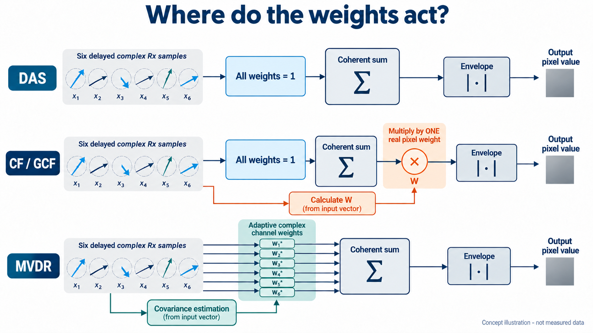

**图 1｜先定位新算法加在流程的哪里。** CF / GCF 的 $W$ 作用于一个像素；MVDR 的权重作用于求和前的接收观测。图中星号表示共轭，实际计算使用 $\mathbf{w}^H$。为了突出位置，图中先画直接通道加权；本章代码还会采用第 4 节的子孔径。AI 概念图不是重建结果。

这也解释了输入要求：**只有一张 DAS B-mode 图，无法补算本章的 MVDR。** 自适应权重需要求和前的复数通道信息。

### 2. 先确定要保留什么：steering vector 与无失真约束

取出一组长度为 $L$ 的对齐观测，写成列向量 $\mathbf{u}\in\mathbb{C}^{L\times1}$。暂时把它理解为 $L$ 个接收通道；第 4 节再说明如何从 $M$ 个通道取出它。

理想情况下，候选位置上一个相干回波经正确延时后，各通道留下相同的复数幅度 $A$：

$$ \mathbf{u}=A\mathbf{a},\qquad \mathbf{a}=[1,1,\ldots,1]^T. $$

$\mathbf{a}$ 叫 **steering vector（导向向量）**：它描述“希望保留的目标，应当在这组接收通道上呈现什么模式”。第一章已经通过 Tx / Rx 延时处理了几何，所以这里的理想目标模式是全 1。它不是在说真实数据的每个通道幅值都一定相同。

用一组复数权重 $\mathbf{w}$ 合成：

$$ y_{\mathrm{unit}}=\mathbf{w}^H\mathbf{u}=\sum_{\ell=1}^{L}w_\ell^*u_\ell. $$

$H$ 表示共轭转置，星号表示复共轭。复数权重既能改变幅值，也能改变相位。

现在提出一个明确要求：如果输入正好是 $A\mathbf{a}$，输出仍应是 $A$。因此：

$$ \mathbf{w}^H\mathbf{a}=1\quad\Longrightarrow\quad \mathbf{w}^H(A\mathbf{a})=A. $$

这就是 **distortionless（无失真）约束**。此处“无失真”是对**预期导向模式**的单位增益约束，不是对所有真实组织回波的保真保证。

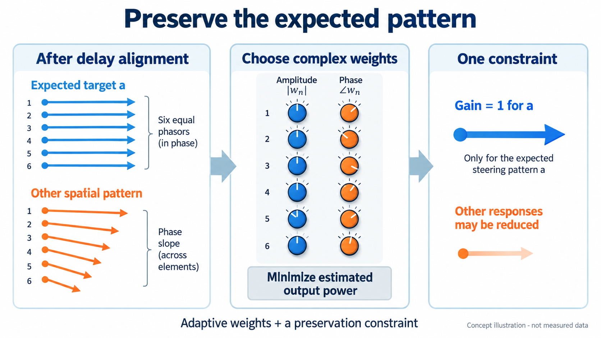

**图 2｜先约定要保留的模式，再调整混合方式。** 蓝色箭头代表理想对齐的目标，橙色箭头代表另一种空间相位模式。权重可以降低其他模式的响应，同时满足蓝色模式的增益为 1。箭头长度是示意；没有保证所有干扰都被消除。

### 3. 再确定优化什么：让估计输出功率尽量小

有了保护目标的约束，还需要一个选择权重的准则。MVDR 选择**满足约束时，估计输出功率最小**的一组权重。

定义接收向量的二阶矩矩阵：

$$ \mathbf{R}=\mathbb{E}\{\mathbf{u}\mathbf{u}^H\}. $$

这里 $\mathbb{E}$ 表示统计平均；$\mathbf{R}$ 的大小为 $L\times L$。对角线记录各位置的样本功率，非对角线记录不同位置的复数相关关系。本章通常沿用文献称它为“协方差矩阵”，实际代码估计的是**不减样本均值的二阶矩**。

把输出功率展开：

$$ \mathbb{E}\{|y_{\mathrm{unit}}|^2\}=\mathbb{E}\{|\mathbf{w}^H\mathbf{u}|^2\}=\mathbf{w}^H\mathbf{R}\mathbf{w}. $$

所以算法问题是：

$$ \min_{\mathbf{w}}\ \mathbf{w}^H\mathbf{R}\mathbf{w}\quad\mathrm{subject\ to}\quad\mathbf{w}^H\mathbf{a}=1. $$

把它读成一句话：**在不削弱预期目标模式的前提下，寻找输出能量较小的接收混合方式。**

为什么不能只说“让输出越小越好”？因为没有约束时，$\mathbf{w}=\mathbf{0}$ 就能得到零输出，连目标也消失了。

$\mathbf{R}$ 来自接收数据，通常同时包含目标、其他散射、干扰和噪声，代码没有一张预先知道的“纯噪声协方差”。在理想模型中，受保护的目标模式对输出功率的贡献被约束固定下来，权重才有空间降低其他贡献。

若 $\mathbf{R}$ 正定，用拉格朗日乘子处理单位增益约束，可得最优条件：

$$ \mathbf{R}\mathbf{w}=\mu\mathbf{a}\quad\Longrightarrow\quad\mathbf{w}=\mu\mathbf{R}^{-1}\mathbf{a}. $$

也就是说，先由相关结构决定权重的方向，再求尺度 $\mu$。因为 $\mathbf{w}^H\mathbf{a}=1$ 与其共轭 $\mathbf{a}^H\mathbf{w}=1$ 等价，代入即可得到：

$$ 1=\mathbf{a}^H\mathbf{w}=\mu\mathbf{a}^H\mathbf{R}^{-1}\mathbf{a}. $$

于是解为：

$$ \mathbf{w}_{\mathrm{MVDR}}=\frac{\mathbf{R}^{-1}\mathbf{a}}{\mathbf{a}^H\mathbf{R}^{-1}\mathbf{a}}. $$

分子给出由相关结构决定的权重方向；分母把它归一化为单位目标增益。先记住这两个作用即可。接下来真正的难点是：**一个像素只给了一组观测，怎样估计可用的 $\mathbf{R}$？**

### 4. 空间平滑：从同一接收孔径取得多个子孔径观测

直接把一个 $M$ 通道向量做外积，得到的 $M\times M$ 矩阵最多只有秩 1。它提供的统计信息不足，不能靠直接求逆得到稳定的完整孔径自适应权重。

本章采用 **spatial smoothing（空间平滑）**：从 $M$ 个连续有效 Rx 通道中，滑动取长度为 $L$ 的重叠子孔径。这里的“平滑”是协方差估计方法，不是在灰阶图上做模糊。

$$ P_{\mathrm{sub}}=M-L+1. $$

为避免与空间位置 $P$ 混淆，正文把子孔径数记为 $P_{\mathrm{sub}}$；代码和配图简写为 `P`。

例如 $M=6$、$L=3$，一共可以取出 4 个子孔径：

| 子孔径 | 选出的列向量 |
|---|---|
| 1 | $\mathbf{u}_1=[s_1,s_2,s_3]^T$ |
| 2 | $\mathbf{u}_2=[s_2,s_3,s_4]^T$ |
| 3 | $\mathbf{u}_3=[s_3,s_4,s_5]^T$ |
| 4 | $\mathbf{u}_4=[s_4,s_5,s_6]^T$ |

把它们按列放在一起：

$$ \mathbf{X}=[\mathbf{u}_1,\mathbf{u}_2,\ldots,\mathbf{u}_{P_{\mathrm{sub}}}]\in\mathbb{C}^{L\times P_{\mathrm{sub}}}. $$

于是空间平滑估计为：

$$ \widehat{\mathbf{R}}_{\mathrm{spatial}}=\frac{1}{P_{\mathrm{sub}}}\sum_{p=1}^{P_{\mathrm{sub}}}\mathbf{u}_p\mathbf{u}_p^H=\frac{\mathbf{X}\mathbf{X}^H}{P_{\mathrm{sub}}}. $$

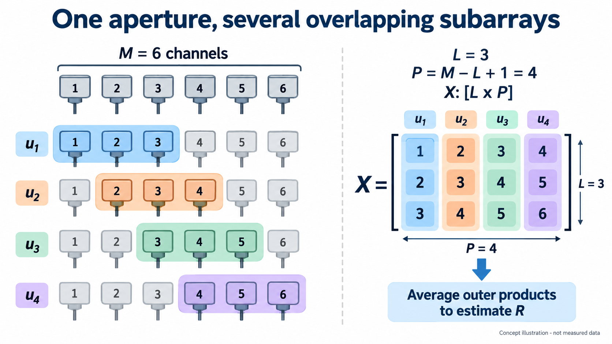

**图 3｜按列堆子孔径，得到 `X[L,P]`。** 左侧彩色区域是实际选中的通道，灰色通道不属于该行子孔径；右侧数字表示原通道索引，不是样本幅值。这里的多列都来自**同一个像素、同一次 Tx 的 Rx 孔径**。

重叠子孔径共享数据，不能把列数直接当作独立观测数。它们的作用是利用接收孔径中的局部结构，构造长度为 $L$ 的统计估计。后面的权重长度也随之变为 $L$，导向向量是 `ones(L,1)`。

空间平滑和对角加载是超声 MV 波束合成中常用的稳健化手段，相关研究可从 [Synnevåg、Austeng 与 Holm（2007）的原始论文](https://pubmed.ncbi.nlm.nih.gov/17703664/) 读起。本教程的具体参数与实现应以本仓库代码为准。

### 5. 轴向邻域：让附近深度参与估计，但只输出当前深度

单个深度的子孔径仍然可能缺少样本多样性。本章进一步使用附近深度的对齐通道，估计当前像素的权重。

固定当前 Tx、横向位置以及**当前像素选出的 Rx 通道集合**。每个邻近深度各自按对应的传播时间取样，再从同一组 Rx 通道提取子孔径：

$$ \widehat{\mathbf{R}}=\frac{1}{N_{\mathrm{snap}}}\sum_{q\in\mathcal{Q}}\sum_{p\in\mathcal{V}_q}\mathbf{u}_{q,p}\mathbf{u}_{q,p}^H. $$

$\mathcal{Q}$ 是轴向邻域，$\mathcal{V}_q$ 是该深度内查询时间有效的子孔径集合，$N_{\mathrm{snap}}=\sum_q|\mathcal{V}_q|$。RTB 还会排除该 Tx 没有发射支持的邻近深度。若所有查询都有效、没有边界截断，才可简写为 $N_{\mathrm{snap}}=Q P_{\mathrm{sub}}$。

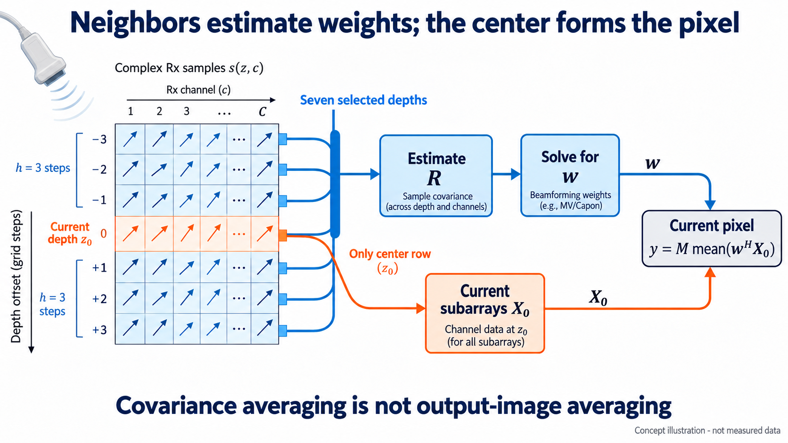

**图 4｜两条路径要分清。** 蓝色邻域和橙色中心一起估计 $\widehat{\mathbf{R}}$、求出 $\mathbf{w}$；真正形成当前像素的输入是橙色中心的子孔径。代码没有把邻居深度的合成幅值平均到当前像素。

`axial_averaging_lambda` 表示以波长为单位的**半窗口**。设输出深度间隔为 $\Delta z$，代码换成网格步数：

$$ h=\operatorname{round}\!\left(\frac{\alpha_{\mathrm{axial}}\lambda}{\Delta z}\right),\qquad Q_{\mathrm{interior}}=2h+1. $$

默认 $\alpha_{\mathrm{axial}}=1.5$，即尝试使用当前深度上下各约 $1.5\lambda$ 的邻域。窗口在图像边界截短；它以**重建深度网格**计数，不以原始 RF 时间样本计数。

这里隐含一个合理但需要检查的假设：小邻域能为当前像素提供相近统计结构。邻居越多不等于越好；如果跨过不同组织或强边界，估计可能混入不同结构。这一点放到第三部分再结合图像判断。

### 6. 对角加载：先让求解稳定，再算自适应权重

即使使用子孔径和轴向邻域，$\widehat{\mathbf{R}}$ 也可能接近奇异。若某些估计特征值很小，直接求解可能对样本误差非常敏感。

本章使用 **diagonal loading（对角加载）**：

$$ \rho=\delta\,\frac{\operatorname{tr}(\widehat{\mathbf{R}})}{L},\qquad \mathbf{R}_{\mathrm{loaded}}=\widehat{\mathbf{R}}+\rho\mathbf{I}. $$

$\delta$ 是无量纲的相对加载系数，默认 0.01。$\operatorname{tr}(\widehat{\mathbf{R}})/L$ 是平均通道样本功率，让加载量随当前数据尺度变化。$\mathbf{I}$ 是单位矩阵。

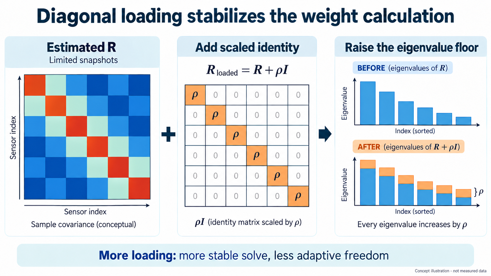

**图 5｜同一个 $\rho$ 加到每个特征值上。** 插图只解释矩阵关系，柱高不是本章测量值。加载改善求解条件，却没有产生新的观测，也没有把目标模式估计得更准确。

实际求解把第 3 节的 $\mathbf{R}$ 换成 $\mathbf{R}_{\mathrm{loaded}}$：

$$ \mathbf{v}=\mathbf{R}_{\mathrm{loaded}}^{-1}\mathbf{a},\qquad \mathbf{w}=\frac{\mathbf{v}}{\mathbf{a}^H\mathbf{v}}. $$

MATLAB 用反斜杠解方程，无需显式计算 `inv`：

~~~matlab
mean_power = real(trace(R))/L;
R_loaded = R + diagonal_loading*mean_power*eye(L);
a = ones(L,1);
v = R_loaded\a;
w = v/(a'*v);
assert(abs(w'*a-1) < 1e-8);
~~~

从优化目标看，加上这个矩阵也等于给大权重增加一个代价：

$$ \mathbf{w}^H\mathbf{R}_{\mathrm{loaded}}\mathbf{w}=\mathbf{w}^H\widehat{\mathbf{R}}\mathbf{w}+\rho\|\mathbf{w}\|_2^2. $$

所以小加载允许较强的自适应变化，也可能更敏感；大加载限制权重变化。这个取舍需要同时看求解稳定性、目标幅值与图像形态，不能只追求最窄的亮点。

### 7. 输出当前像素：对子孔径相干合成，再匹配 DAS 的幅度约定

此时权重长度是 $L$，中心深度有 $P_{\mathrm{sub}}$ 个子孔径。当前像素的单位增益输出为：

$$ y_{\mathrm{unit}}(P)=\frac{1}{P_{\mathrm{sub}}}\sum_{p=1}^{P_{\mathrm{sub}}}\mathbf{w}^H\mathbf{u}_{0,p}. $$

先合成各个子孔径，再对这些**复数输出**求平均。下标 0 强调输入来自当前深度；邻近深度只参与估计权重。

这里有一个容易漏掉的尺度问题。如果所有 $M$ 个通道都是同一个复数 $A$，单位增益 MVDR 输出为 $A$，而第一章的求和式 DAS 输出为 $MA$。直接画共同参考图，会把两种定义的尺度差误当作算法抑制。

因此本章实现采用：

$$ Y_{\mathrm{MVDR}}(P)=M\,y_{\mathrm{unit}}(P),\qquad Y_{\mathrm{DAS}}(P)=\sum_{m=1}^{M}s_m(P). $$

对完全相干的理想输入，两者都给出 $MA$。**乘回的是有效完整接收孔径的 $M$，不是子孔径长度 $L$，也不是子孔径数。** 这只是匹配幅度约定，不保证任意真实向量下 MVDR 与 DAS 的输出相等。

对应代码只有三步：

~~~matlab
subarray_output = w'*X_center;     % [1,P]，仍是复数
y_unit_gain = mean(subarray_output);
y = M*y_unit_gain;
~~~

此处不能先 `abs` 再平均：那会丢掉子孔径之间的相位关系，变成另一种合成方式。

### 8. 把完整算法接回 conventional FI 与 RTB

到这里，一个像素的接收 MVDR 已经完整了：

~~~text
按当前像素计算 Tx/Rx delay，取复数样本
    → 选择有效连续 Rx 孔径，得到 M
    → 取长度 L 的重叠子孔径
    → 当前及邻近深度的有效子孔径估计 R
    → 对角加载，求 w，检查 w^H a = 1
    → w 作用于中心深度的各子孔径
    → 平均复数输出并乘 M
~~~

**Conventional FI** 沿用第一章“一次 Tx 对应一条输出扫描线”的路线。每条扫描线逐深度执行上述接收算法，得到 `mvdr_analytic[z,scanline]`，最后取包络和 dB。

**RTB** 则在一个公共 $(x,z)$ 网格上重建各次聚焦 Tx。对每个有支持的 `Tx/pixel`，先完成接收 MVDR，再使用第一章同样的 Tx 权重相干合成：

$$ Y_{\mathrm{RTB\text{-}MVDR}}(P)=\frac{\sum_{k\in\mathcal{K}(P)}t_k(P)\,Y_{\mathrm{MVDR},k}(P)}{\sum_{k\in\mathcal{K}(P)}t_k(P)}. $$

这里 $t_k$ 是 RTB 的非负 Tx 权重，$\mathcal{K}(P)$ 是有发射支持的 Tx 集合；该式对应 `normalize_tx_weights=true` 且分母非零的像素。

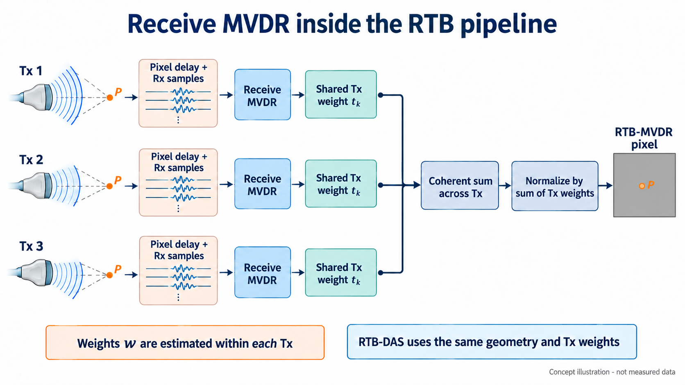

**图 6｜两次“合成”对应两个不同维度。** 每一行先沿 Rx 做 MVDR，行与行之间再沿 Tx 相干合成。本章权重不是从“各次 Tx 的输出向量”求出来的，没有实现 transmit-domain MV。

RTB-DAS 与 RTB-MVDR 的对照共用同一 Tx delay model、Tx support / window、Rx F-number、输出网格、所选 Tx 和跨 Tx 归一化。接收组合分别使用 DAS 与 MVDR。因此图像差异更容易对应到这一步变化。

**现在应能回答主线问题：MVDR 先从数据估计接收相关结构，再在保护预期目标模式的约束下求复数权重，用这些权重合成当前像素；它不是对最终灰阶图做锐化。**

## 第二部分：按主线运行 MATLAB 实验

### 9. 先用人工向量，把每一步算出来

运行 [demo_mvdr_building_blocks.m](../../matlab/03_MVDR/demo_mvdr_building_blocks.m)，不需要 USTB 或 UFF：

~~~matlab
cd D:/Ultrasound_Beamforming_Learning/matlab/03_MVDR
demo_mvdr_building_blocks
~~~

它用固定 `rng(3)` 生成五组图。这里是**窄带复数向量模型**：横轴 `q` 是每通道的相位坡度，单位 cycles/channel。它不是 MHz、不是角度，也不是从真实 RF 重建出来的超声 PSF。

#### 9.1 先看权重怎样改变接收响应

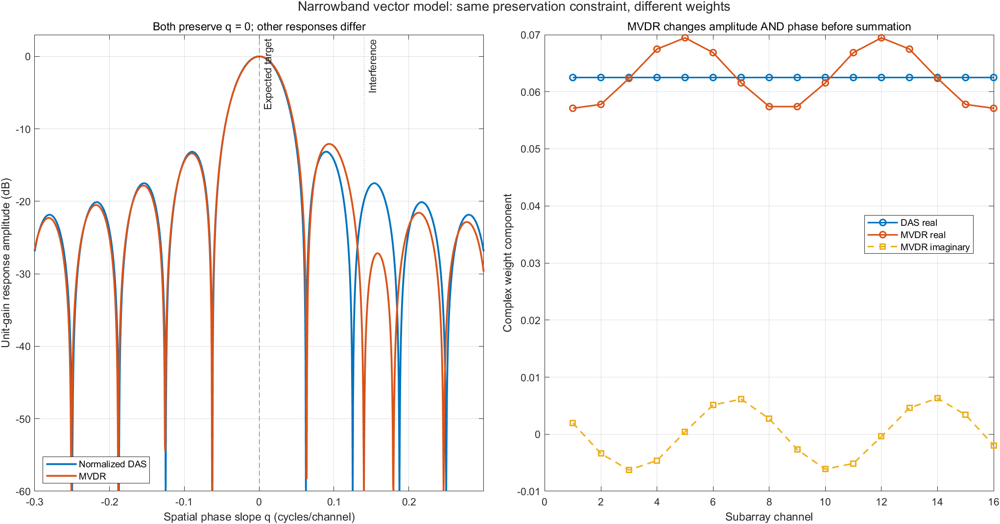

**图 7｜两个方法都保留 `q=0`，但对其他模式的响应不同。** 左侧采用相同的单位目标增益，右侧展示接收权重的实部与虚部。这里的 DAS 使用归一化权重 `ones(L,1)/L`；实数据图的 DAS 仍使用通道求和约定。

该人工模型明确包含理想目标、相位坡干扰和白噪声。示例检查了 `w'*a=1`，并核对在相同加载矩阵下，MVDR 的目标函数值不大于归一化 DAS。这个数学检查支持“权重确实解了所写的优化问题”，不等于已经证明真实人体成像更好。

#### 9.2 再看子孔径怎样排成矩阵

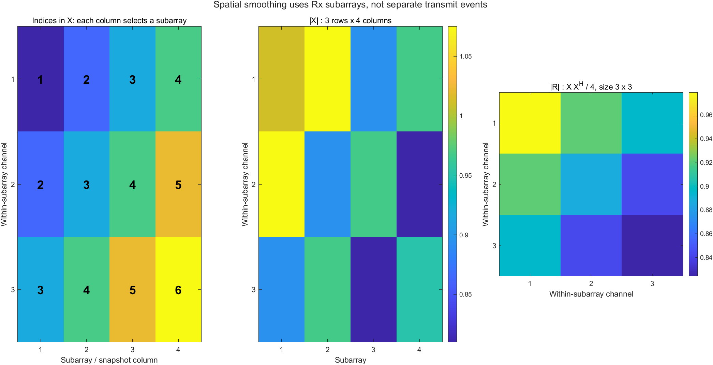

**图 8｜把图 3 的索引变成实际 MATLAB 计算。** `M=6,L=3,P=4`；左图是原通道索引，中图是样本幅值，右图是二阶矩幅值。索引图的数字不是测得的 RF 幅度。

这一步最适合停下来对照：

~~~matlab
index_matrix = (0:L-1).' + (1:P);
X = s(index_matrix);          % [L,P]
R = X*X'/P;                  % [L,L]，' 是共轭转置
~~~

`X*X'` 不是逐元素相乘，也不是 `X*X.'`。复数数据需要保留共轭关系。

#### 9.3 邻域和加载分别补了什么

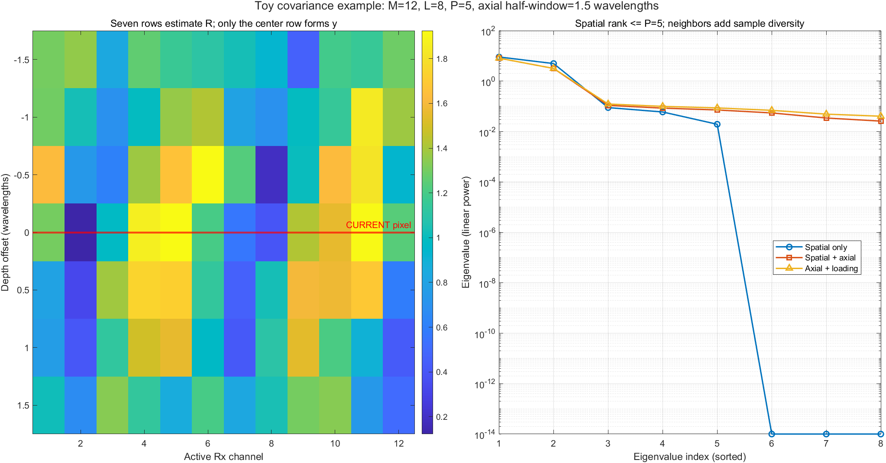

**图 9｜此图换成 `M=12,L=8,P=5`，展示样本不足的情形。** 单深度估计的秩最多为 5；该固定随机例子加入七行后得到秩 8。加载进一步抬高特征值。重叠子孔径与邻近深度都相关，增加列数不保证真实场景一定满秩。

左侧中心线是实际用于输出的深度。示例还验证理想相干输入时，`M*mean(w'*X_center)` 与 `M*A` 一致。

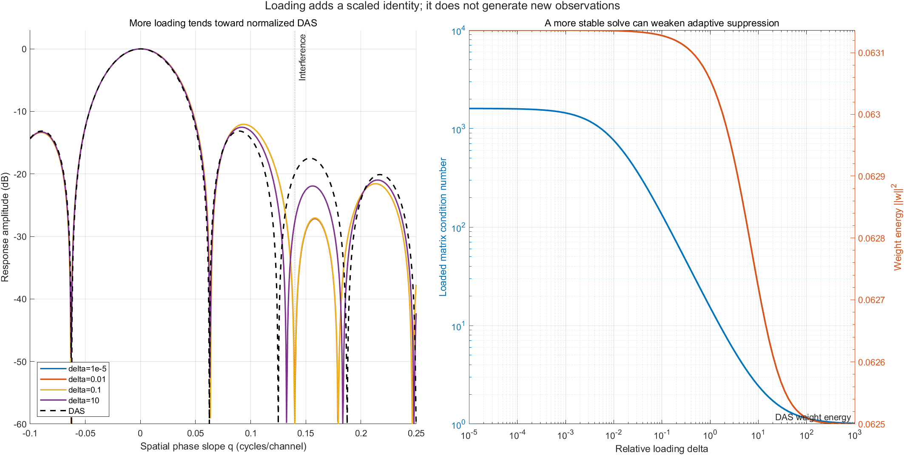

**图 10｜改变加载，保持同一个人工模型与约束。** 左图看干扰模式的响应，右图分别用纵轴显示矩阵条件数与权重能量。加载很大时，这个直接向量示例接近归一化 DAS；真实代码还包含子孔径平均，第 14 节会解释其中的差别。

#### 9.4 约束模式与真实模式不一致时会怎样

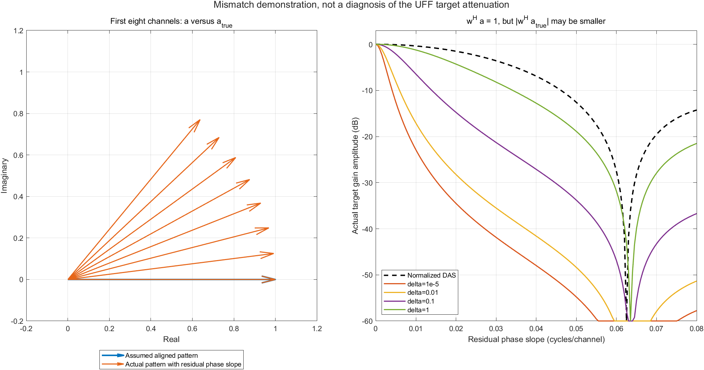

**图 11｜每次仍满足 `w'*a=1`，实际目标增益却可以下降。** 左图蓝色理想相量彼此重合，橙色相量逐通道增加残余相位；右图改变实际目标模式，但约束始终使用全 1 的 `a`。协方差包含实际目标，因此可以出现目标自抑制。

这个实验解释一种**可能机制**。它不能用来断言 TheGB 中的峰值降低就是声速错误造成的；真实数据还涉及有限样本、模型近似与孔径幅值变化。

### 10. 回到真实数据：先看完整图，再看参数变化

先显式指定 TheGB 教学数据：

~~~matlab
addpath(genpath('D:/USTB'));
cd D:/Ultrasound_Beamforming_Learning/matlab/03_MVDR
filename = '../../data/L7_FI_TheGB.uff';
n_z = 256;
axial_averaging_lambda = 1.5;
compare_manual_das_vs_mvdr
~~~

`compare_manual_das_vs_mvdr.m` 当前默认文件是 `L7_FI_carotid_cross_2.uff`；上面的显式 `filename` 让本节与课件图使用同一份 phantom 数据。Exporter 也显式传入 TheGB。

#### 10.1 只用空间子孔径，和加入轴向邻域的对照

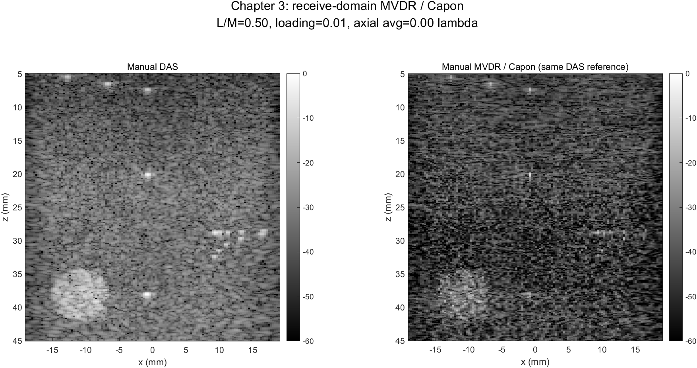

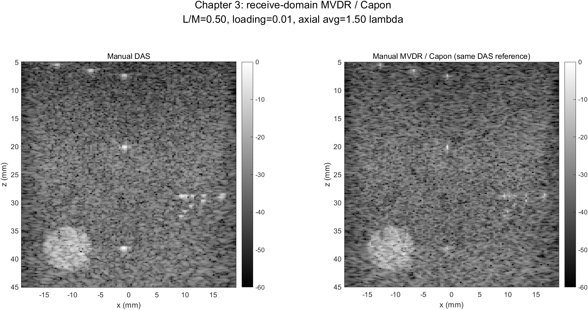

**图 12｜同一数据、同一网格、同一 DAS 参考，只改变协方差的轴向半窗口。** 上图 `axial_averaging_lambda=0`，下图为 1.5；其他 MVDR 参数都是 `L/M=0.5`、`loading=0.01`。两个图的 DAS 都与第一章独立核心实现进行了复数输出回归比较。

本次运行的 MVDR 全局峰值相对 DAS 全局峰值分别为 **−7.469 dB** 与 **−3.778 dB**。这里比较的是整张图各自的最大值，不保证来自同一坐标，也不是局部目标增益的测量。

加入轴向邻域后，本图的纹理和亮度分布发生变化。请同时比较点状结构与周围组织；不能只用“整体变亮了”判定参数更好。各自峰值归一化的补充图见 [空间版](figures/compare_manual_das_vs_mvdr_spatial_only_02.png) 和 [轴向版](figures/compare_manual_das_vs_mvdr_axial_02.png)。

#### 10.2 把子孔径长度与加载分开改变

运行：

~~~matlab
filename = '../../data/L7_FI_TheGB.uff';
experiment_mvdr_tradeoffs
~~~

脚本只重建目标附近 `z=18–22.5 mm`、`n_z=160`，保留 conventional 扫描线。四组设置是：

| 设置 | 子孔径比例 | 相对加载 | 单独考察什么 |
|---|---:|---:|---|
| 短子孔径 | 0.25 | 0.01 | 较短局部孔径，更多重叠子孔径 |
| 基线 | 0.50 | 0.01 | 本章起始配置 |
| 长子孔径 | 0.75 | 0.01 | 较长局部孔径，更少重叠子孔径 |
| 较大加载 | 0.50 | 0.10 | 在相同子孔径比例下限制自适应变化 |

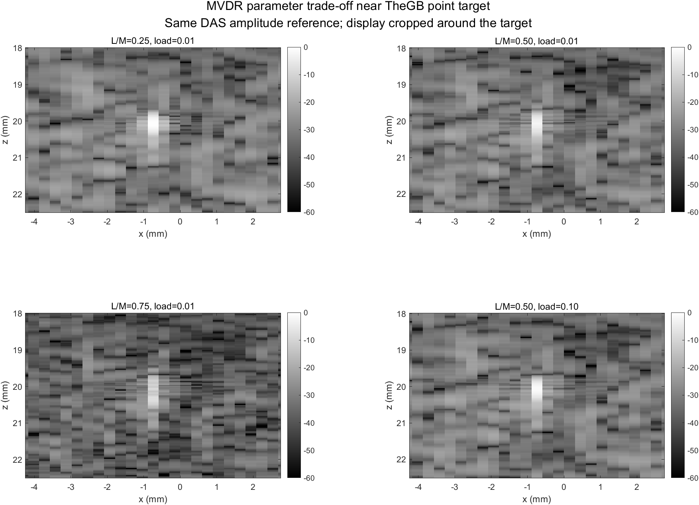

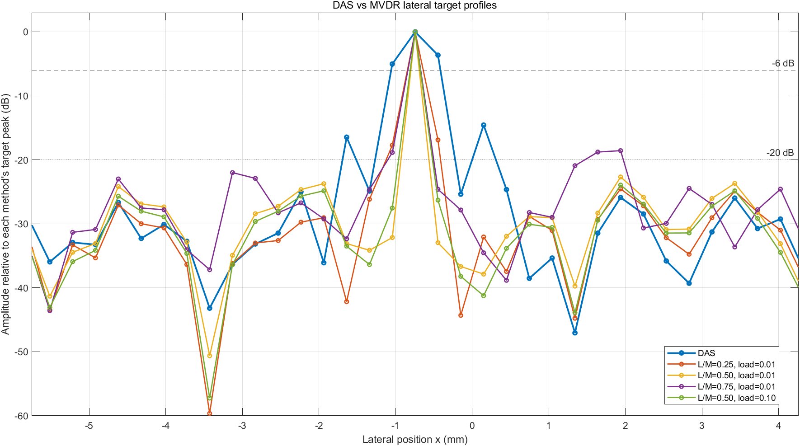

**图 13｜图像先看幅值代价，剖面再看形状变化。** 四组协方差都使用约 $\pm1.5\lambda$ 轴向邻域。上图只将显示范围裁到目标横向 ±3.5 mm；重建、共同 DAS 参考和数值测量没有变化。下图圆点标出实际扫描线采样，每条剖面按该方法自己的目标峰值归一化；它隐藏了峰值差，应与上图和日志中的 `peak_change_dB` 一起读。

脚本验证四组 DAS 基线一致。本次横向间隔约 0.298 mm，四组 MVDR 的测得半幅宽约 0.305–0.345 mm，仅约一个网格间距；不宜把这些插值数值当作精确分辨率证据。下面改用密网格 RTB，继续检查这一点。

### 11. 用密网格 RTB 验证目标响应：宽度和峰值一起看

RTB 提供更密的公共横向网格，但不会凭空创造原始观测。这一步的目的，是减少“亮点只剩一条扫描线，测宽度却像很精确”的误读。

~~~matlab
filename = '../../data/L7_FI_TheGB.uff';
x_min = -4e-3; x_max = 3e-3; n_x = 281;
z_min = 18e-3; z_max = 22.5e-3; n_z = 181;
subarray_fraction = 0.5; diagonal_loading = 0.01;
axial_averaging_lambda = 1.5; forward_backward = false;
run_rtb_reference_check = true;
compare_rtb_das_vs_rtb_mvdr
~~~

图中 $\Delta x=\Delta z=0.025$ mm。RTB 使用 `blended` Tx model、`blending_power=0.5`、Tx F# 2、最小支持 3 mm、`tukey25` 和 Rx F# 1.7；全部 128 次 Tx 参与。`pw_margin=1 mm` 也保存在配置中，但只在 `hybrid` 分支生效，本次 `blended` 不使用它。目标搜索 seed 为 `[x,z]=[-0.745,20.10]` mm，各方法在同一局部搜索区域内寻找自己的峰。

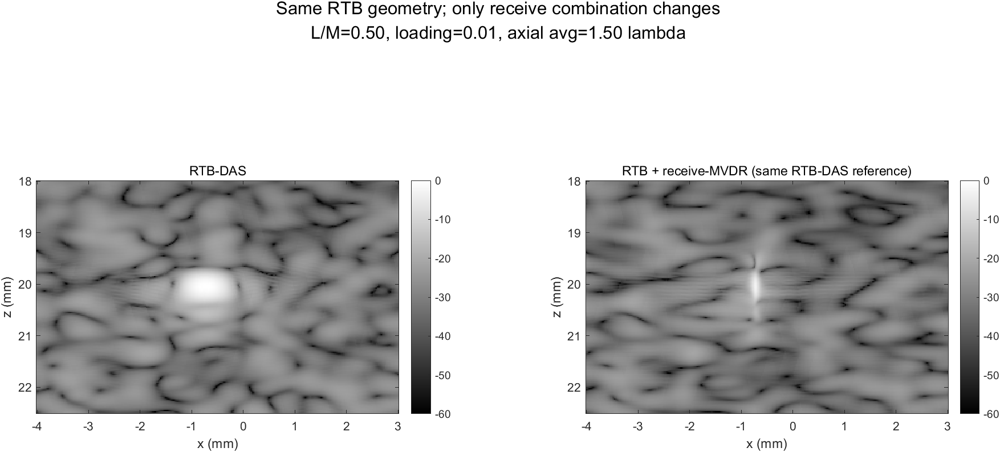

**图 14｜先比较同一个 RTB-DAS 参考下的幅值与形态。** 两个分支共用 RTB 几何和 Tx 合成，仅接收组合不同。脚本还把 RTB-DAS 与第一章 `reconstruct_fi_rtb_manual.m` 作复数回归检查。

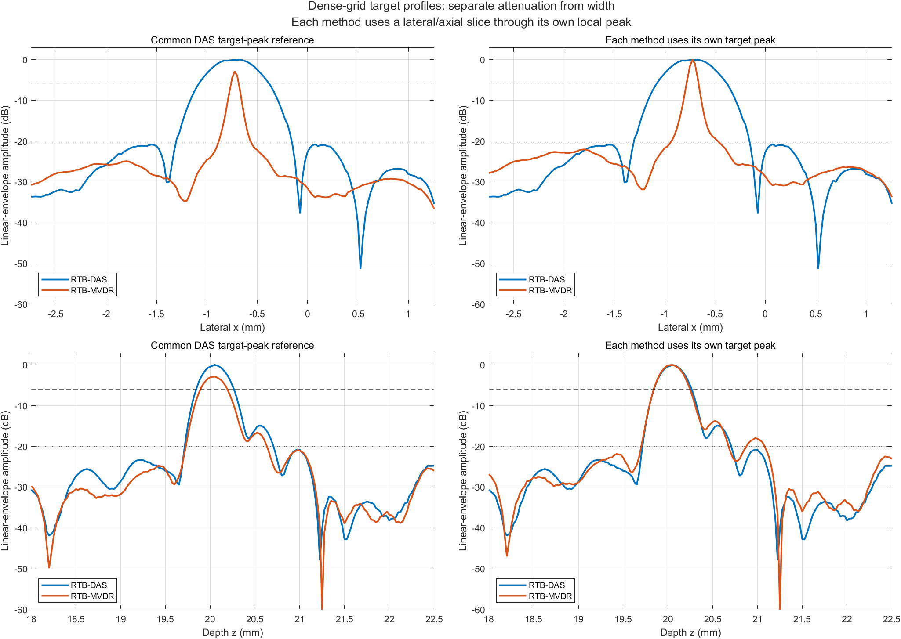

**图 15｜左列保留局部目标峰值差，右列比较各自归一化后的形状。** 第一行横向，第二行轴向；各方法沿自己的局部峰取剖面。宽度在未裁剪线性包络上计算，不能从已裁剪的灰阶图反推。

本次实际运行结果如下，完整输出见 [phantom 日志](figures/matlab_phantom_results.txt)：

| 局部目标指标 | RTB-DAS | RTB-MVDR |
|---|---:|---:|
| 横向包络半幅宽 | 0.7063 mm | 0.1238 mm |
| 轴向包络半幅宽 | 0.4231 mm | 0.4071 mm |
| 横向 −20 dB 宽 | 1.1482 mm | 0.4617 mm |
| 峰位置 $(x,z)$ | (−0.6750, 20.0500) mm | (−0.7250, 20.0500) mm |

MVDR 的局部峰值相对 DAS 为 **−2.893 dB**，横向半幅宽约跨 **4.953 个网格间隔**；fallback 为 `0/795264` 次 Tx/pixel 接收处理尝试。RTB-DAS 与第一章参考实现的最大复数误差为 0。

这次实验支持一个有限结论：在该目标、该配置和该网格上，接收 MVDR 明显收窄了横向响应，同时降低了局部目标峰值；轴向半幅宽变化较小。它不支持“所有组织都提升同样倍数的分辨率”，也不说明峰值降低的具体原因已经查明。

原脚本的“横向剖面 + 自归一化图像”也已导出为 [补充课件图](figures/compare_rtb_das_vs_rtb_mvdr_02.png)。看自归一化图时，请同时展示图 14 或图 15 左列，避免把幅值降低隐藏起来。

### 12. 把同一实现放到人体数据：观察结构，也保留解释边界

运行第一组或第二组独立 acquisition：

~~~matlab
dataset_index = 1;       % 第二组改成 2
x_min = -10e-3; x_max = 10e-3; n_x = 161;
z_min = 8e-3; z_max = 25e-3; n_z = 171;
wave_stride = 2;
subarray_fraction = 0.5; diagonal_loading = 0.01;
axial_averaging_lambda = 1.5; forward_backward = false;
compare_carotid_rtb_das_vs_rtb_mvdr
~~~

这里显式写出全部网格覆盖参数，避免上一节的目标 ROI 变量被脚本保留。`wave_stride=2` 表示选用每隔一次的 Tx，便于在透明的 MATLAB 教学实现中控制运行时间；两种方法仍使用相同的 Tx 子集。

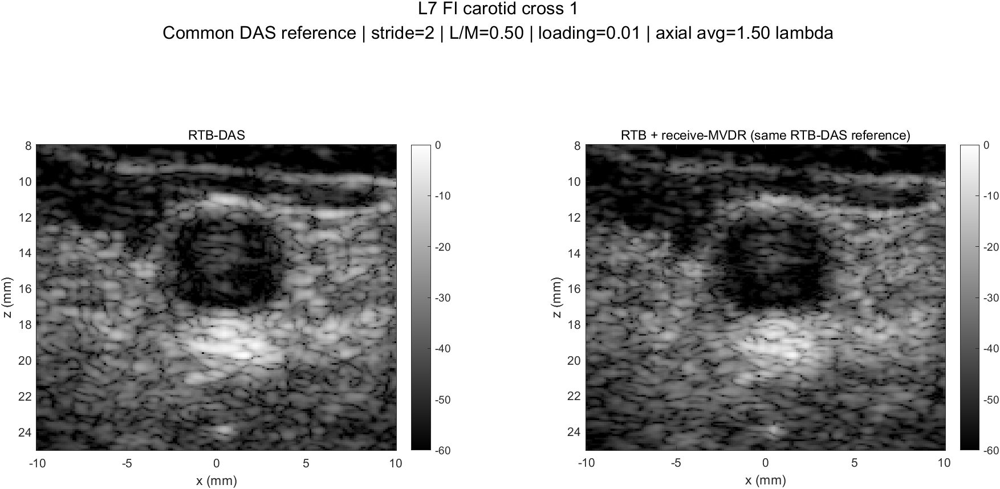

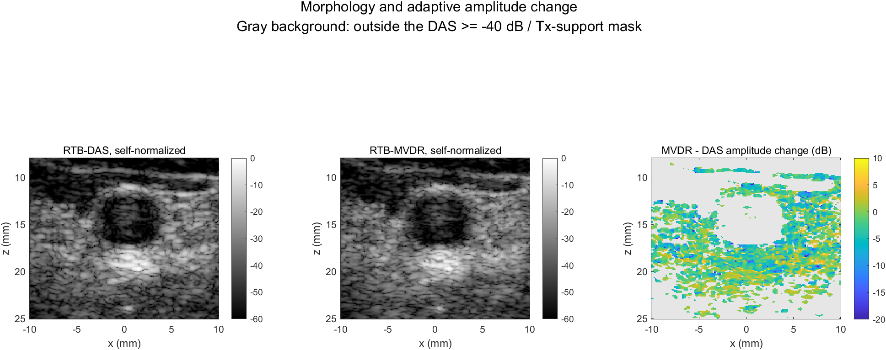

**图 16｜第一组 acquisition。** 上图用共同 DAS 参考；下图分别归一化显示灰阶形态，并给出彩色 MVDR−DAS 的 dB 幅值比。差图只显示 DAS 不低于 −40 dB 且 Tx 支持非零的像素；灰色背景表示掩膜外，不是测得的抑制值。

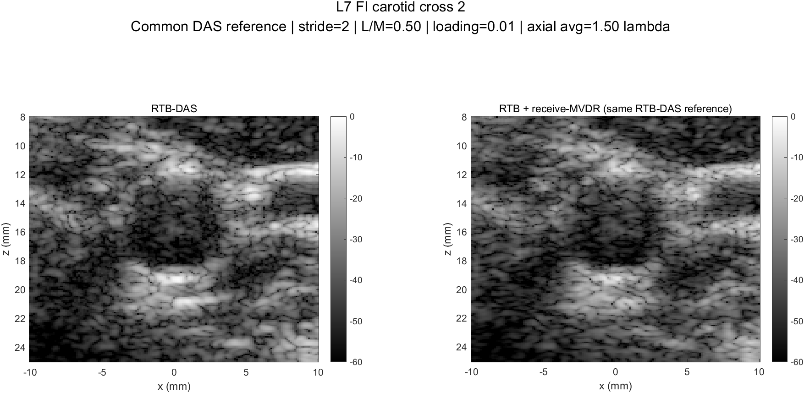

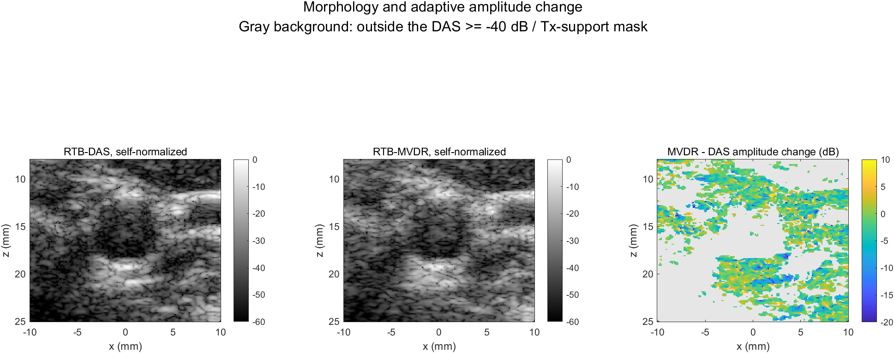

**图 17｜第二组是独立 acquisition，不是第一组的下一帧。** 同样先看共同参考，再看自归一化形态和幅值差。两组数据应在各自的 DAS 参考内比较，不能把不同 acquisition 的亮度直接当作算法增益。

本次两组都使用 $\Delta x=0.125$ mm、$\Delta z=0.100$ mm 和 64 次 Tx。日志中的描述统计为：

| 指标 | Cross 1 | Cross 2 |
|---|---:|---:|
| MVDR 全局峰值相对 DAS | −2.040 dB | −3.330 dB |
| 掩膜内幅值变化中位数 | −1.697 dB | −1.452 dB |
| 掩膜内包络相关系数 | 0.9518 | 0.9133 |
| Fallback / Tx-pixel 尝试 | 0 / 150354 | 0 / 151302 |

主要结构在本次 ROI 中仍可对应，局部幅值和纹理发生变化；没有复现图 15 中点状目标那种同等程度的横向收窄。相关系数描述两个包络的相似程度，不表示谁更接近真值。完整统计与参数见 [carotid 日志](figures/matlab_carotid_results.txt)。

这些数据没有理想图像真值。更暗的管腔、更细的亮边或改变的 speckle，都需要进一步验证，不能单独作为临床性能结论。本节先训练读者描述“哪里发生了什么变化”，再讨论变化是否符合成像任务。

## 第三部分：集中解释实现与读图注意事项

### 13. 读代码时，先认清数组、维度和共轭

| 变量 | 形状 / 单位 | 在主线中的作用 |
|---|---|---|
| 原始 RF | `[sample,Rx,Tx,frame]`，本章是实数 RF | UFF 输入，选 frame 1 |
| `analytic_wave` | `[sample,Rx]`，复数 | 沿时间采样维做解析信号转换 |
| `samples` / `aligned_by_depth` | `[z,Rx]`，复数 | 当前 Tx / 横向位置下，不同深度的对齐样本 |
| `center_s` | `[1,M]`，复数 | 当前像素选出的有效连续 Rx |
| `X_center` | `[L,P]`，复数 | 中心深度的重叠子孔径 |
| `R` / `R_loaded` | `[L,L]`，复 Hermitian，样本幅度平方 | 当前像素的二阶矩估计 / 加载矩阵 |
| `a` / `w` | `[L,1]`，复数 | 预期模式 / 自适应权重 |
| 图像复数输出 | `[z,scanline]` 或 `[z,x]` | conventional 或 RTB 的相干结果 |
| `x_axis,z_axis` | m；画图乘 `1e3` | 几何坐标，不能把数组索引直接当 mm |

核心实现见 [conventional 接收 MVDR](../../matlab/03_MVDR/reconstruct_fi_mvdr_manual.m) 和 [RTB 接收 MVDR](../../matlab/03_MVDR/reconstruct_fi_rtb_mvdr_manual.m)。建议先沿 `mvdr_pixel` 阅读 `X_center → R → R_loaded → w → y`，再返回外层 Tx / 像素循环。

MATLAB 的 `'` 是共轭转置，`.'` 只转置。索引网格用 `(0:L-1).'`，二阶矩与输出分别用 `Xq*Xq'`、`w'*X_center`。这些写法有不同用途，不能随意替换。

核心接受 `modulation_frequency=0` 的实数 RF，内部转解析信号；不能把任意已有 complex IQ 文件当作同样输入。本章限定二维线阵聚焦成像，时间索引和 Tx / Rx delay 语义继续遵循第一章。

### 14. 四个主要参数，分别改变哪一步

| 参数 | 默认 | 实际改变 | 阅读时的判断 |
|---|---:|---|---|
| Rx F-number | 1.7 | 完整有效 Rx 孔径 $M$ | 先保证 DAS / MVDR 用同样的孔径 |
| `subarray_fraction` | 0.5 | 从 $M$ 选出子孔径长度 $L$ | 增大 $L$ 同时增大矩阵、减少子孔径数 |
| `axial_averaging_lambda` | 1.5 | 估计二阶矩的深度邻域 | 增加邻域不等于增加独立样本 |
| `diagonal_loading` | 0.01 | 加到估计矩阵上的 $\rho I$ | 在自适应响应与求解稳健性之间取舍 |

代码先取 `floor(subarray_fraction*M)`，再约束 $2\le L\le M-1$；小孔径时实际 $L/M$ 未必正好等于所写比例。连续 Rx 集合也是本章滑动子孔径的前提。

#### 14.1 半窗口要结合网格看

本次 TheGB 读取的波长约 0.295680 mm。完整图 `n_z=256`、深度 5–45 mm 时，$\Delta z\approx0.156863$ mm，默认半窗口取 $h=3$，实际半宽约 0.470588 mm。密网格目标 $\Delta z=0.025$ mm 时，$h=18$，实际半宽 0.450000 mm。

同样写“1.5 波长”，离散网格上的行数不同，实际半宽也有舍入差。因此比较不同 `n_z` 的实验时，要同时记录 $\Delta z$、`h` 与实际毫米范围。

#### 14.2 很大加载为什么只是“更像固定权重”

当加载占主导时，子孔径权重趋向：

$$ \mathbf{w}\longrightarrow\frac{\mathbf{a}}{\mathbf{a}^H\mathbf{a}}=\frac{1}{L}\mathbf{1}_L. $$

这是**子孔径内的等权平均**。真实实现还要对重叠子孔径平均，孔径中部通道往往被重复选入更多次：

$$ Y_{\mathrm{large\ load}}\longrightarrow\frac{M}{L P_{\mathrm{sub}}}\sum_{m=1}^{M}c_m\,s_m. $$

$c_m$ 是第 $m$ 个通道出现于子孔径中的次数。例如图 3 的六通道中，次数为 $[1,2,3,3,2,1]$。所以很大加载会接近某种固定接收加权，**不保证对任意向量严格等于完整孔径的 boxcar DAS**。对完全相干的输入，幅度约定仍与 DAS 一致。

#### 14.3 Forward-backward averaging 是另一个可选估计步骤

当前课件默认 `forward_backward=false`。若开启，代码在加载前使用反序矩阵 $\mathbf{J}$：

$$ \widehat{\mathbf{R}}_{\mathrm{FB}}=\frac{1}{2}\left(\widehat{\mathbf{R}}+\mathbf{J}\widehat{\mathbf{R}}^*\mathbf{J}\right). $$

这里星号表示元素复共轭。它引入前后对称的阵列统计假设，不是增加一份真实采集。先学清默认流程，再单独开启观察；不要与子孔径、加载同时改动后把变化归因给其中一个参数。

### 15. 读图要分开看幅值、形状、采样和失配

#### 15.1 共同参考与各自峰值参考回答不同问题

共同 DAS 参考保留相对幅值变化：

$$ I_{\mathrm{common}}=20\log_{10}\!\left(\frac{|Y|}{A_{\mathrm{DAS,ref}}}\right). $$

各自峰值参考更便于比较形状，却隐藏方法间峰值差：

$$ I_{\mathrm{self}}=20\log_{10}\!\left(\frac{|Y|}{\max|Y|}\right). $$

实际代码有零值保护与动态范围裁剪。图像通常显示 −60 到 0 dB，超出显示上限或落在裁剪地板的差异不能从灰阶直接定量读取。**宽度和幅值比应从未裁剪线性包络计算。**

#### 15.2 本章 FWHM 指包络半幅宽，不是半功率宽

脚本测量主峰两侧最近的阈值交点，再线性插值。半幅阈值与 −20 dB 阈值分别是：

$$ A_{\mathrm{half}}=0.5A_{\mathrm{peak}},\qquad 20\log_{10}(0.5)\approx-6.0206\ \mathrm{dB},\qquad A_{-20}=0.1A_{\mathrm{peak}}. $$

这里不是功率的 −3 dB 半高。横向宽度还要与 $\Delta x$ 一起读：只跨一两格的窄峰，不能用插值后的很多小数掩盖采样不足。密网格降低这个问题，但不会将一次局部目标响应变成普遍分辨率结论。

全局峰值比、各方法局部峰值比，以及同一坐标的幅值比，也不是同一个指标。图 12 用全局峰；图 15 和目标日志用同一搜索区域中的各自局部峰。

#### 15.3 目标也可能被当成需要压低的模式

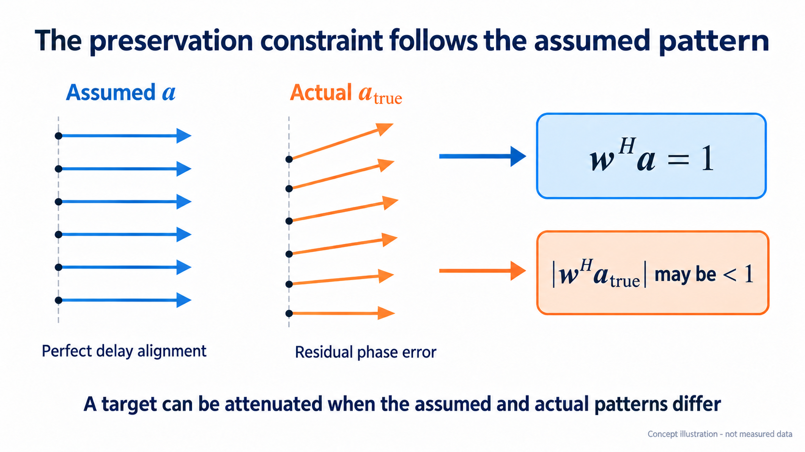

**图 18｜“约束满足”与“真实目标保真”之间还有一个模型匹配条件。** 阵元幅值不一致、延时或声速近似、波前模型误差等，都可能让实际模式 $\mathbf{a}_{\mathrm{true}}$ 与假定 $\mathbf{a}$ 不同。此时：

$$ \mathbf{w}^H\mathbf{a}=1\quad\not\Rightarrow\quad\mathbf{w}^H\mathbf{a}_{\mathrm{true}}=1. $$

图 11 给出了实际数值例子。要判断某个 UFF 目标为何衰减，需要另外做受控验证，不能只看图像后猜原因。导向失配与稳健波束合成的关系可参考 [Lorenz 与 Boyd 的作者原文](https://web.stanford.edu/~boyd/papers/pdf/rmvbBookChapter.pdf)。

#### 15.4 Fallback 为零，也不等于估计一定准确

有效通道太少、没有可用子孔径或估计功率退化等情况下，代码退回该 `Tx/pixel` 的 DAS。RTB 日志中的分母是**有 Tx 支持的接收处理尝试次数**，不是图像像素数；同一个空间像素可被多次 Tx 计数。

Fallback 检查的是算法是否走了备用分支，不检测协方差偏差或目标失配。没有 fallback，仍可能出现不理想的目标幅值或纹理。Conventional 核心没有暴露同样的计数器，本章不为它报告“0% fallback”。

### 16. 两个扩展方向：它们分别想解决什么

先学完本章接收 MVDR，再了解这两个名字即可。仓库当前没有对应变体实现，配图也没有把它们作为已运行结果。

**EIBMV / ESMV：利用协方差的特征子空间。** 对估计矩阵做特征分解，按规则选出一个子空间 $\mathbf{E}_s$，把 MV 权重投影进去：

$$ \widetilde{\mathbf{w}}=\mathbf{E}_s\mathbf{E}_s^H\mathbf{w}_{\mathrm{MVDR}}. $$

这是投影思路的示意，不是完整算法。投影后的权重一般不自动满足原来的单位增益约束；子空间如何选、是否以及怎样重新归一化，都需要具体定义与验证。不能把“大特征值”直接等同于真实组织，也不能把“更低秩”自动理解为更好。

[Asl 与 Mahloojifar（2010）的原始 EIBMV 论文](https://pubmed.ncbi.nlm.nih.gov/21041127/) 采用协方差特征结构投影 MV 权重；文献报告的收益对应其模拟与实验条件，应与本仓库结果分开看。

**RCB：把导向向量的不确定性纳入设计。** 标准 MVDR 只保护一个指定 $\mathbf{a}$。稳健 Capon 方法进一步描述允许的导向误差集合，例如围绕名义向量的一个范数球：

$$ \mathcal{A}=\{\mathbf{a}_0+\mathbf{e}:\|\mathbf{e}\|_2\le\epsilon\}. $$

不同稳健形式的优化约束、估计量和归一化并不完全相同，这里只介绍“不确定集合”的思路。随手增大 `diagonal_loading` 不能直接称为已经实现 RCB；[Li、Stoica 与 Wang（2003）的原始论文](https://doi.org/10.1109/TSP.2003.812831) 将导向不确定集合与所需加载联系起来。

两个方向都需要新的选择规则和验证条件，不属于本章已经运行的标准接收 MVDR。

### 17. 用五个问题检查自己是否理解主线

1. MVDR 和 CF / GCF 的权重分别作用在哪里？
2. 为什么最小输出功率必须配合 $\mathbf{w}^H\mathbf{a}=1$？
3. $M=6,L=3$ 时，`X` 是什么形状？`R` 又是什么形状？
4. 轴向邻域参加估计后，当前输出是否混入邻近深度的合成幅值？
5. 为什么“目标更窄、fallback 为零”还不足以证明整体图像更好？

展开参考答案

1. CF / GCF 给已求和的复数像素乘实数权重；MVDR 在相干求和前给接收观测施加复数权重。
2. 没有约束时，所有权重取零就能获得零功率；约束保护预期导向模式。
3. 子孔径数为 4，`X` 是 `[3,4]`，`R` 是 `[3,3]`。
4. 邻域用来估计 `R` 和 `w`；输出使用中心深度的子孔径，平均的是这些中心子孔径的复数输出。
5. 还要核对峰值代价、采样间隔、模型匹配、组织纹理与任务相关指标；fallback 只表示是否走了备用分支。

下一章 DMAS / fDMAS 会继续从对齐通道出发，研究通道之间的成对组合。继续学习之前，应能沿 `s → X → R → R_loaded → w → Y` 在代码和图中完整走一遍。
