# 第 4 章：DMAS / fDMAS——从通道配对到一幅图像

前面三章，我们一直在回答：**同一个像素对应的多条接收信号，怎样合成一个输出？**

DAS 把延时对齐的通道相加；CF / GCF 用孔径内的一致性给输出加权；MVDR 根据局部协方差调整接收权重。这一章保留相同的延时、插值和接收孔径，改用一种新的组合方式：**先让通道两两配对，再求和，最后选择需要的频带。**

学完后，你应能沿着下面这条线，把公式、代码和图像对应起来：

> **延时后的实数 RF → signed-sqrt 通道配对 → 快速求和与幅度约定 → 约 2f₀ 带通 → 包络 → B-mode → 有边界的实验结论。**

本章讲 conventional focused imaging（FI）中的 **receive-domain real-RF DMAS / fDMAS**。第 1–7 节连续讲理论；第 8 节用小实验看清运算；第 9 节解读真实 UFF 图像；最后集中讨论实现和比较时的注意事项。

[MATLAB 运行说明](../../matlab/04_DMAS/README.md) · [配图与课件索引](figures/README.md) · [上一章：MVDR](../03_MVDR/README.md)

## 本章学习入口

> **推荐顺序：** 先理解通道两两配对与 signed-sqrt，再看滤波及输出采样；最后做真实 RF 对照。
>
> **最短实践：** `demo_dmas_building_blocks` → `compare_fi_das_vs_fdmas`（第一步无需数据；第二步需要 USTB/UFF）。区分非线性幅度与二倍频滤波。详细命令与参数以 [MATLAB 运行说明](../../matlab/04_DMAS/README.md) 为准。

**章节导航：** [← 上一章](../03_MVDR/README.md) · [课程目录](../../README.md) · [MATLAB 运行说明](../../matlab/04_DMAS/README.md) · [配图与实验记录](figures/README.md) · [完整中文 PDF](../../output/pdf/第04章_DMAS与fDMAS.pdf) · [下一章 →](../05_SLSC/README.md)

> 先沿正文的**原理与计算主线**阅读，再运行小例子或真实数据；实验观察、实现细节及自测放在主线之后。PDF 包含完整配图，GitHub 上的独立 PNG 未提交。

---

## 1. 先看全貌：DMAS 换掉了哪一步？

假设正在重建像素 P。[第一章的几何与延时](../01_DAS_Real_UFF/README.md)已经告诉我们：应该到每个接收通道的什么时间位置取样。经过 fractional-sample interpolation，再保留当前接收孔径内且取样有效的通道，就得到这个像素的输入向量。

**DMAS 从这里接手。它仍然需要正确的 delay；通道相乘不能替代聚焦。**

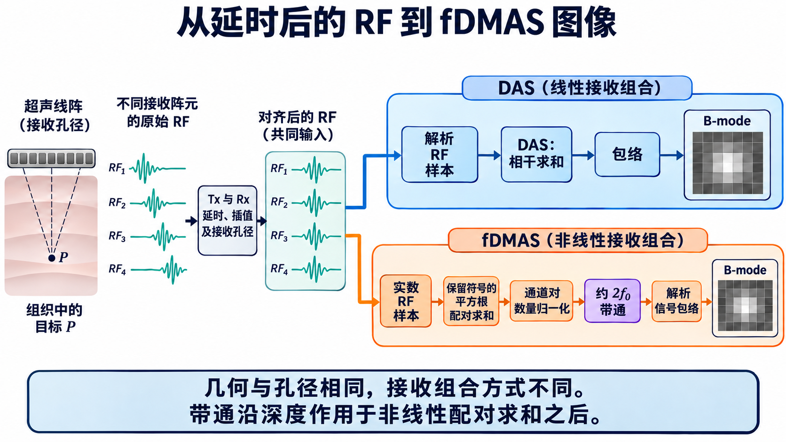

**图 1 怎么讲：** 先指向中间的“对齐后的 RF”，说明两条路径共享几何和孔径；再沿下方橙色路径走一遍。带通在配对求和之后、包络之前，作用方向是每条 scanline（扫描线）的深度轴。图中的波形与像素方格是 AI 概念示意，不是实验数据。

把前几章放在一起看，会更容易定位新算法：

| 方法 | 对延时后的接收通道做什么 | 本章需要记住的区别 |
|---|---|---|
| DAS | 按给定接收权重相加 | 基线是线性的通道组合 |
| CF / GCF | 从孔径一致性得到标量权重 | 改变 DAS 输出的强弱 |
| MVDR | 估计协方差并求接收权重 | 对每个像素使用自适应线性组合 |
| DMAS / fDMAS | 非线性配对求和，再提取约 2f₀ 频带 | 同时改变通道组合和输出频谱 |

这里的“线性”指在几何、孔径和权重已固定时的接收组合；完整 B-mode 中的取模、归一化、log 显示仍然是非线性的。MVDR 的权重又来自数据，因此不能把整个自适应处理流程称为固定线性算子。

## 2. 从四个通道出发：为什么要配对？

### 2.1 DAS 先问“相加后是多少”

设当前像素有 M 个有效接收通道，延时后的**实数 RF** 为：

$$ \mathbf{s}(P)=[s_1(P),s_2(P),\ldots,s_M(P)]\in\mathbb{R}^{1\times M}. $$

本节先省略 P，忽略额外加窗，实数 RF 的 DAS 就是：

$$ y_{\mathrm{DAS,RF}}=\sum_{i=1}^{M}s_i. $$

读这个公式时，只需要想象：每个通道交出一个有正负号的数，DAS 把它们加起来。

### 2.2 最直接的 DMAS 改问“每两条通道怎样相乘”

先用普通乘积理解配对的结构：

$$ y_{\mathrm{pair}}=\sum_{1\le i<j\le M}s_i s_j. $$

四个通道时，唯一的通道对是：

~~~text
(1,2)  (1,3)  (1,4)  (2,3)  (2,4)  (3,4)
~~~

共有六项。自己与自己不配对，(2,1) 也不会在 (1,2) 之后再计算一次。

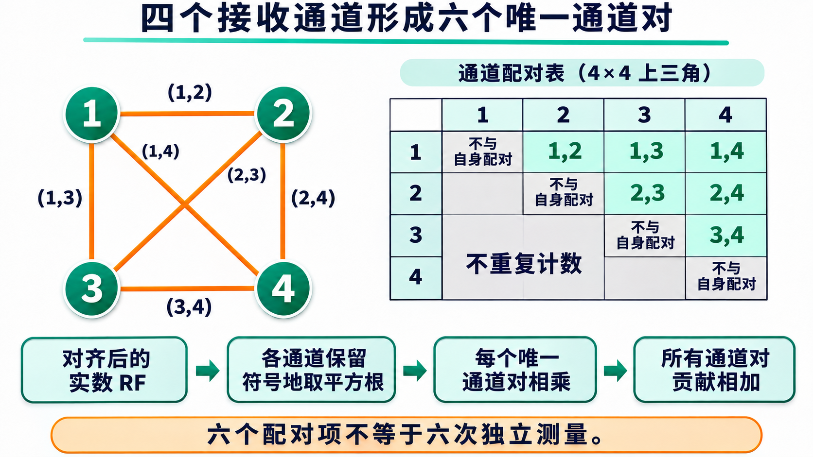

**图 2 怎么讲：** 左图看连接关系，右图看求和范围。只把矩阵上三角的六个格子相加；对角线和下三角都排除。六个乘积仍然来自原来的四条通道，不能当成六次独立采集。

在理想的对齐回波中，同一时刻很多通道同号，两两相乘会得到很多正贡献。通道不一致时，正负乘积可能互相抵消。这让 DMAS 对孔径内的一致性产生不同于 DAS 的响应。

“对一致性敏感”还不是完整算法：普通乘积会把幅度平方，下一步要处理这个问题。

### 2.3 signed-sqrt：保留乘积符号，调整幅度尺度

经典超声 DMAS 常用下面的通道对贡献：

$$ g(s_i,s_j)=\operatorname{sign}(s_i s_j)\sqrt{|s_i s_j|}. $$

因此，本章所说的 signed-sqrt DMAS 为：

$$ D(\mathbf{s})=\sum_{i<j}\operatorname{sign}(s_i s_j)\sqrt{|s_i s_j|}. $$

其中 sign 保留乘积的正负号，sqrt 把共同输入幅度的缩放关系从二次改成一次。**这仍然是非线性运算**，并不会变回 DAS。[原始超声 DMAS 论文](https://doi.org/10.1109/TMI.2014.2371235)是进一步阅读这一方法的起点；本章的符号、快速式和归一化约定会在下面逐一展开。

用三个四通道例子算一次，就能避免“DMAS 总是正数”或“负数就是没有目标”的误解：

| 延时后的实数 RF | DAS | 未归一化的 signed-sqrt DMAS | 为什么 |
|---|---:|---:|---|
| [1, 1, 1, 1] | 4 | 6 | 六对全部贡献 +1 |
| [-1, -1, -1, -1] | -4 | 6 | 两个负数的乘积也是正数 |
| [1, -1, 1, -1] | 0 | -2 | 两个正贡献、四个负贡献 |

所以，**原始 DMAS sample 可以为负；但把所有 RF 通道一起反号，DMAS 的结果不变。** 这些都是单个时刻的数值，还没有构成包络图像。

## 3. 把两两配对变成快速求和

直接枚举通道对的数量为：

$$ N_{\mathrm{pairs}}=\frac{M(M-1)}{2}. $$

M 较大时，逐对计算需要 O(M²) 的工作量。signed-sqrt 可以先作用在每个通道上：

$$ u_i=\operatorname{sign}(s_i)\sqrt{|s_i|}. $$

对于实数输入，两个 u 的乘积正好就是需要的通道对贡献：

$$ u_i u_j=\operatorname{sign}(s_i s_j)\sqrt{|s_i s_j|}. $$

然后展开“和的平方”：

$$ \left(\sum_i u_i\right)^2=\sum_i u_i^2+2\sum_{i<j}u_i u_j. $$

移项后得到：

$$ \boxed{D(\mathbf{s})=\frac{1}{2}\left[\left(\sum_i u_i\right)^2-\sum_i u_i^2\right].} $$

这不是另一种 DMAS，也不是近似算法。它是**同一个配对定义的 O(M) 等价写法**：先对各通道变换，做两个求和，再相减。浮点计算中，两种累加顺序可能产生很小的舍入差异。

对应 MATLAB 只有三行：

~~~matlab
% s: one pixel, M active channels, REAL delayed RF samples
u = sign(s).*sqrt(abs(s));
pair_sum = 0.5*(sum(u).^2 - sum(u.^2));
~~~

sum(u) 的平方包含所有交叉项；sum(u.^2) 是每个通道自己的平方和。后者负责去掉不应存在的 self-pairs。

## 4. 幅度怎样变化？先理解非线性，再理解归一化

### 4.1 所有通道相同，也不会回到有符号的 DAS

如果每个有效通道都是同一个实数 s，每个 signed-sqrt pair 都贡献 |s|：

$$ D(s\mathbf{1})=\frac{M(M-1)}{2}|s|. $$

与之相比，DAS 是 Ms。两者除了通道数量的尺度不同，还有一个关键区别：**全局 RF 正负号在 DMAS 中消失了。**

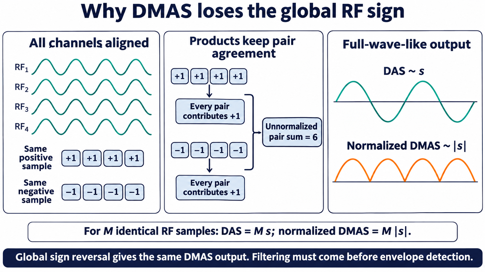

**图 3 怎么讲：** 先比较四个 +1 与四个 -1；再看右侧波形。全相干的正弦输入经过 signed-sqrt 配对后呈现 |s| 式的全波整流形状。这个特例为下一节解释 2f₀ 提供直觉，并不表示一般 DMAS 都是非负信号。

对于任意实数比例 a，还有：

$$ D(a\mathbf{s})=|a|D(\mathbf{s}),\qquad D(-\mathbf{s})=D(\mathbf{s}). $$

因此正比例放大输入会同比放大输出，但反号不会反转输出；也不能假设两个场景叠加后的 DMAS 等于各自 DMAS 的和。

### 4.2 为什么项目额外乘 2/(M−1)？

动态接收 F-number 下，M 往往随深度和横向位置变化。若直接使用原始 pair sum，即使每通道的全相干 RF 幅度相同，通道数增加也会带来 M(M−1)/2 的配对数量因子。

本项目为教学比较采用：

$$ \widetilde{D}(\mathbf{s})=\frac{2}{M-1}D(\mathbf{s}),\qquad M\ge2. $$

于是，在所有通道相同的特例下：

$$ \widetilde{D}(s\mathbf{1})=M|s|. $$

这把全相干输出对通道数的增长从近似二次变成一次。M 小于 2 时没有有效通道对，代码把 DMAS 输出设为 0。

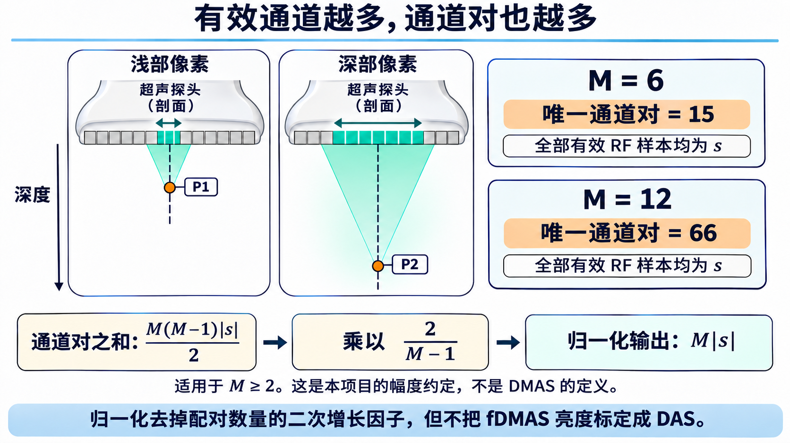

**图 4 怎么讲：** 相同 receive F# 下，更深的像素通常使用更宽的接收孔径。左侧探头分块仅示意孔径宽窄，右侧卡片给出计数例子：六通道有十五对，十二通道有六十六对。归一化去掉了这个额外的二次增长，但没有恢复 RF 符号，也没有把最终 fDMAS 亮度标定成 DAS 亮度。

**请区分三个名称：** D 是 signed-sqrt DMAS 定义；本项目的 dmas_unfiltered 保存带 2/(M−1) 约定的输出；fDMAS 则还要经过后面的带通和包络。归一化不是算法原始定义的一部分。

## 5. 为什么要 filtered？沿着波形看 2f₀ 的来源

### 5.1 普通乘积先给出最容易理解的例子

设两条实数窄带信号的载频都约为 f₀，忽略包络，普通余弦乘积为：

$$ \cos(2\pi f_0t+\phi_i)\cos(2\pi f_0t+\phi_j)=\frac{1}{2}\cos(\phi_i-\phi_j)+\frac{1}{2}\cos(4\pi f_0t+\phi_i+\phi_j). $$

右边有一项与时间无关，另一项在 2f₀ 附近。带上脉冲包络后，零频附近也会有一定带宽，因此更适合称为“低频成分”。

这里还可以看到，乘积随通道间的相位关系改变；配对不是单纯改变总增益。

### 5.2 signed-sqrt 并不严格只有 DC 与 2f₀

上一式解释的是普通乘积，不能原封不动当成 signed-sqrt 后的全部频谱。

回到全相干特例，归一化输出正比于 |cos(2πf₀t)|。它的周期是原来的一半，包含 DC、2f₀ 和更高偶次谐波。一般回波还叠加了有限带宽、通道幅相差异等因素，频谱会更复杂。

fDMAS 的 f 就是 **filtered**：从非线性组合后的信号中，提取约 2f₀ 的频带，再做包络检波。

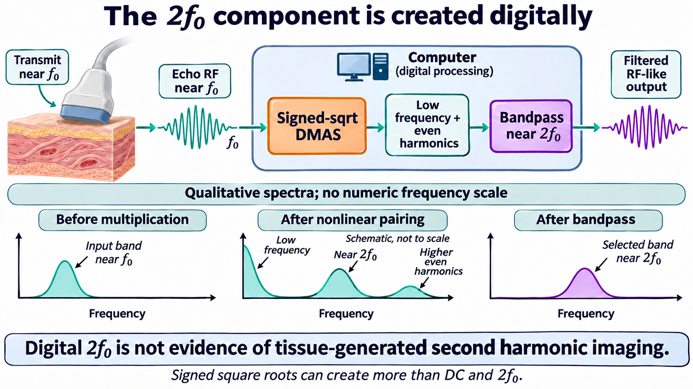

**图 5 怎么讲：** 先区分“组织里的声传播”与“计算机里的通道运算”。这里讨论的 2f₀ 成分由数字非线性组合产生，不能据此说做了 tissue harmonic imaging。下方频谱仅表示频带关系，准确曲线见后面的 MATLAB 实验。

### 5.3 本章怎样取出这一频带？

本项目沿每条 scanline 的深度轴，用双边、实数、偶对称的 raised-cosine FFT mask。正频率部分的四个边界为：

$$ [F_1,F_2,F_3,F_4]=[1.5,1.75,2.5,2.75]f_0. $$

| 频率范围 | 处理 |
|---|---|
| 低于 1.5f₀ | 抑制 |
| 1.5–1.75f₀ | 平滑进入通带 |
| 1.75–2.5f₀ | 保留 |
| 2.5–2.75f₀ | 平滑退出通带 |
| 高于 2.75f₀ | 抑制 |

负频率使用对称的 mask，使滤波后的 RF-like 输出保持为实数。代码先 zero-pad，再在频域相乘，最后裁回原深度长度。该 mask 在频域没有相位延迟，但有限深度区间的边界效应仍然存在。

本项目用元数据给出的波长换算 nominal f₀；实际回波谱峰未必就在它上面。因此需要同时观察“输入频谱”和“滤波窗口”。

[USTB 的官方实现](https://github.com/unioslo/USTB/blob/master/%2Bpostprocess/delay_multiply_and_sum.m)也提供实数通道配对和后续带通，但使用 FIR 滤波；它的默认中心频率估计等约定与本项目也有区别。这里借助官方实现理解处理阶段，不声称两者的 fDMAS 输出逐点数值等价。

### 5.4 最后才是包络和显示

将约 2f₀ 的带通输出记为 yF，其 analytic signal 与包络为：

$$ y_{\mathrm{F,a}}(z)=y_{\mathrm F}(z)+j\mathcal{H}\{y_{\mathrm F}(z)\},\qquad E_{\mathrm F}(z)=|y_{\mathrm{F,a}}(z)|. $$

这里 H 表示沿深度的 Hilbert 变换；代码用 FFT 构造 analytic signal。取 abs(dmas_unfiltered)，或者直接对未滤波 DMAS 做 Hilbert 包络，都会得到**另一种处理结果**。

显示时才进行：

$$ B(z,x)=20\log_{10}\!\left(\frac{E(z,x)}{E_{\mathrm{ref}}}\right). $$

本章 B-mode 每种方法使用自己的全图峰值作为 Eref，再把显示下限截到 −60 dB。后文的目标剖面另用各自的**局部目标峰值**，图注会明确说明。

## 6. 为什么原来能显示 B-mode 的深度网格，现在可能不够？

### 6.1 采集采样率与图像采样率是两件事

原始通道数据沿采集时间以 fs 采样；重建结果沿深度以 Δz 取样。它们不是同一个轴，也不必具有相同的等效采样率。

在近似双程 image-time 坐标下：

$$ t_{\mathrm{image}}\approx\frac{2z}{c},\qquad \Delta t_{\mathrm{image}}\approx\frac{2\Delta z}{c},\qquad f_{s,z}=\frac{c}{2\Delta z}. $$

因为现在还要对重建后的 RF-like 输出保留约 2f₀ 的频带，深度网格必须承载它，而不能只够显示一个平滑的包络。

### 6.2 从滤波上沿推到网格约束

代码检查：

$$ \frac{f_{s,z}}{2}>F_4=2.75f_0. $$

结合波长定义，可以写成：

$$ \lambda=\frac{c}{f_0},\qquad \Delta z<\frac{c}{11f_0}=\frac{\lambda}{11}. $$

项目自动选择 Δz 不大于约 λ/16，而不是紧贴 λ/11 的边界。若恰好取 λ/16，则有：

$$ \Delta z=\frac{\lambda}{16}\ \Longrightarrow\ f_{s,z}=8f_0,\qquad \frac{f_{s,z}}{2}=4f_0. $$

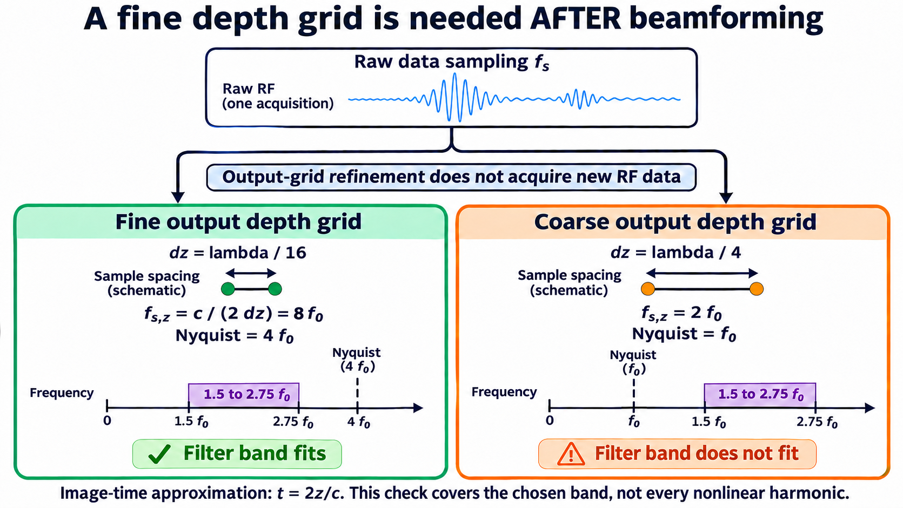

**图 6 怎么讲：** 左图让 2.75f₀ 的上沿落在 Nyquist 之内；右图的粗网格连目标频带都容纳不下。加密的是重建时的取样位置，不是补采了新的 RF 数据，也不会凭空增加独立的横向扫描线。

这是一条**所选输出滤波频带的必要检查**。signed-sqrt 会产生更高频成分，因此它不能证明所有非线性谐波都无混叠；2z/c 对离轴接收路径也只是 image-time 近似。更严格的混叠控制与传播建模需要另外验证。[USTB 的 FI 官方示例](https://unioslo.github.io/USTB/examples/publications/TUFFC/Prieur_fDMAS_2018/FI_UFF_FIeldII_simulations_Fig2_and_Fig3.html)同样说明了 DMAS 的人工二次谐波为何要求较密的深度网格。

## 7. 把理论连成完整算法

现在再看流程，每一步都应有明确的理由：

~~~text
原始实数 RF 通道数据
    ↓ 逐 Tx 取出 [采集样本, Rx]；本章每次 Tx 对应一条聚焦扫描线
Tx / Rx 延时 + 非整数样本插值 + 有效接收孔径
    ├─ 解析 RF 通道相加 → DAS 解析输出 → DAS 包络
    └─ 实数 RF → 保留符号的平方根 → O(M) 通道配对求和
                                     ↓
                             乘 2/(M−1)，M≥2
                                     ↓
                       沿深度：约 2f0 FFT 带通
                                     ↓
                         解析信号 → 包络
                                     ↓
                     各自全图峰值归一化 → 对数压缩 → B-mode
~~~

实际实现的一个细节是：先对每个通道的整段 RF 构造 analytic signal，再进行插值。DAS 使用插值后的复数值，DMAS 使用它的实部。**没有把复数 IQ 的乘积塞进上述 signed-sqrt 定义。**

把核心运算压缩成伪代码：

~~~matlab
% Per pixel: samples are interpolated ANALYTIC RF from active Rx channels.
das_pixel = sum(samples);
s = real(samples);
M = numel(s);
if M >= 2
    u = sign(s).*sqrt(abs(s));
    dmas_pixel = (sum(u).^2 - sum(u.^2))/(M-1);
else
    dmas_pixel = 0;
end
% After filling the whole [Nz,Nx] image:
% dmas_unfiltered -> axial 2*f0 bandpass -> analytic signal -> abs
~~~

这里没有 covariance inversion，也没有跨 Tx 的自适应组合。本章保留 conventional FI：横向位置取各次 focused Tx 的 source.x，形成一条条 scanline；不把 RTB 的密横向网格结果混入本次比较。

## 8. MATLAB 小实验：先在可控条件下看懂运算

运行入口不依赖 USTB 或 UFF：

~~~matlab
cd('D:/Ultrasound_Beamforming_Learning/matlab/04_DMAS');
demo_dmas_building_blocks
~~~

脚本固定 rng(4)，产生六张原理图，并用断言检查配对恒等式、全局反号不变性、幅度缩放、全相干归一化和采样示例。下面的合成波形使用 f₀=5 MHz；这是便于讲解的设定，区别于后面 UFF 元数据中的 nominal f₀。

### 8.1 真正把六个通道对画出来

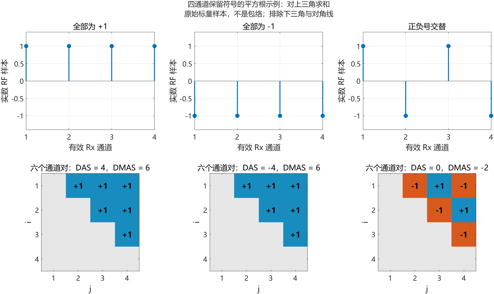

**先看什么：** 上排是输入 RF sample，下排只显示允许参与求和的上三角。全正、全负都得到 +6；正负交错得到 −2。把第 2 节的手算结果与每个格子的符号逐一对应起来。

### 8.2 快速式与幅度约定是两件不同的事

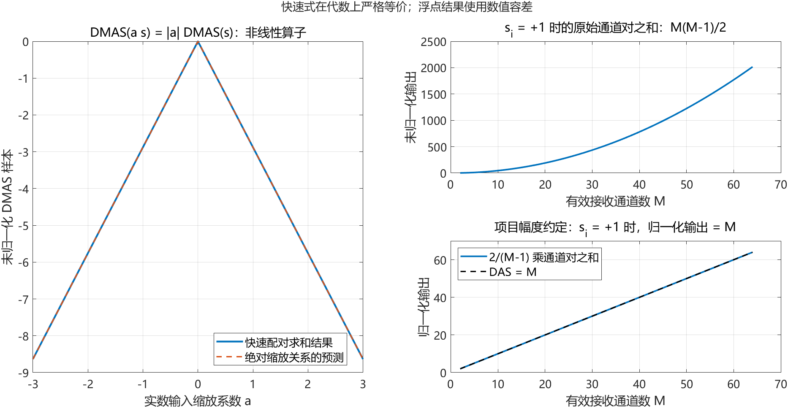

**先看什么：** 左侧两条线重合，验证共同缩放遵循 |a|，图中原始向量的 DMAS 为负，因此呈倒 V 形。右侧分别展示原始 pair count 的增长和归一化后的线性增长，纵轴尺度不同。快速求和改的是计算方式；2/(M−1) 改的是输出约定。

本次小实验在多个通道数与确定性随机向量上，显式枚举与快速式的最大 scaled error 约为 6.86×10⁻¹⁷；全相干 M|s| 检查误差约为 5.33×10⁻¹⁵。数值记录在[原理实验日志](figures/matlab_concepts_results.txt)。

### 8.3 普通乘积与 signed-sqrt 的频谱不同

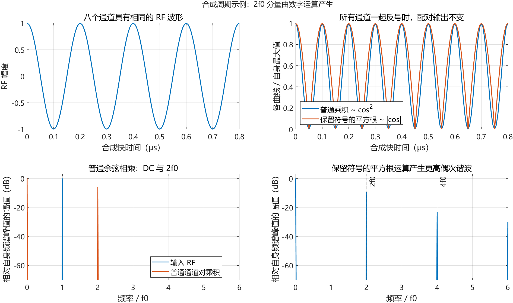

**先看什么：** 上排的平方和绝对值都缩短了周期，但波形不同；下排可见普通余弦乘积主要是 DC 与 2f₀，而 signed-sqrt 的全相干特例还有 4f₀ 等分量。每条频谱各自归一化，不能从两种颜色的高度直接比较绝对能量。

这张图解释“为什么需要约 2f₀ 带通”，也解释“为什么不能声称非线性运算只产生两个频率”。

### 8.4 先取包络与先滤波，不是同一条路径

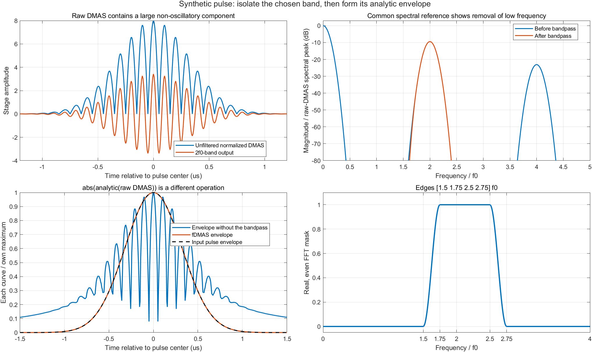

**先看什么：** 左上原始 DMAS 的非振荡成分很强；右上使用同一个频谱参考值，显示低频被抑制。左下直接对 raw DMAS 做 analytic envelope，会留下与 fDMAS 不同的起伏和尾部。右下是真正使用的 raised-cosine mask。

这是一组已知输入包络的合成例子，适合验证处理顺序；不能把其中较平滑的曲线当成真实组织“去噪”的证据。

### 8.5 一眼看见粗网格怎样丢掉 2f₀

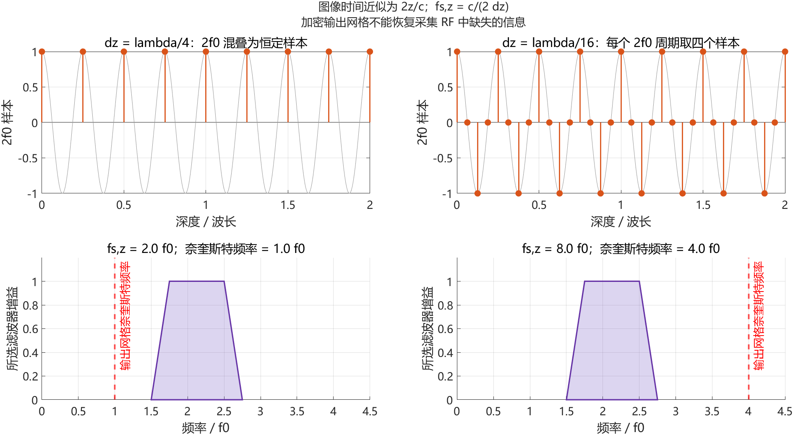

**先看什么：** 左上粗网格的点恰好每次采到同一相位，原本的 2f₀ 振荡看起来成了常数；右上细网格每个 2f₀ 周期有四个点。下排把同一个滤波频带与各自 Nyquist 放在一起。

这是刻意选择的正弦与采样相位，用来揭示混叠机制；一般粗采样的结果未必恰好是常数。

### 8.6 对一致性敏感，也可能改变真实目标

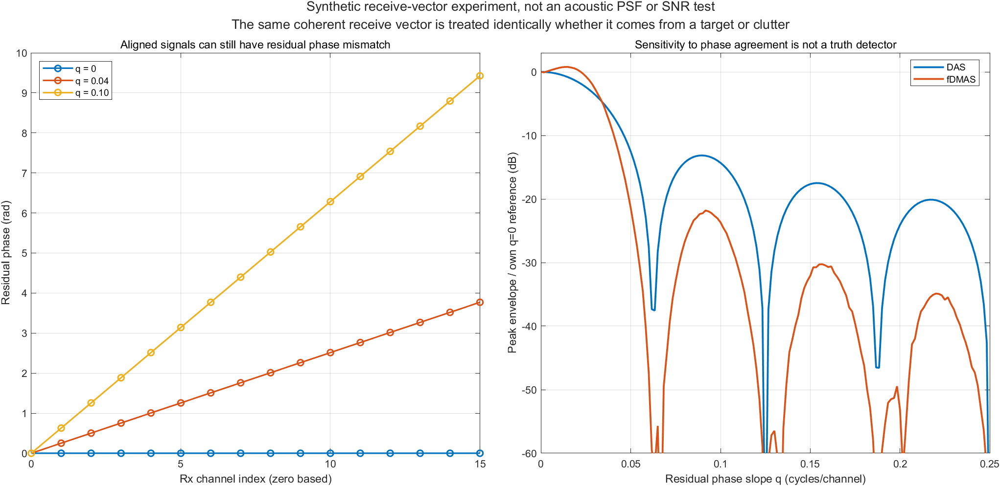

**先看什么：** q 是每个通道累积的残余相位斜率，单位为 cycles/channel，既不是 MHz，也不是成像角度。每种方法都用自己的 q=0 输出作参考。

本例很多位置的 fDMAS 响应下降得更强，但也存在小幅非单调变化。曲线描述的是这组接收向量和滤波器的响应，不能当成通用声束图。若真实目标因声速误差等原因没有充分对齐，它也可能被改变；如果杂波恰好有同样的相干通道向量，算法也不会凭来源把它区分出来。

## 9. 真实 UFF 实验：从完整图像走到一条 scanline

### 9.1 固定比较条件，再运行

本次使用 data/L7_FI_TheGB.uff 的第 1 帧，所有 128 条 focused scanlines，深度 5–45 mm。两种方法共享同一输出网格、Tx/Rx delay、线性插值以及 receive F#=1.7 的 boxcar 孔径。

运行完整对照：

~~~matlab
addpath(genpath('D:/USTB'));  % 按本机 USTB 位置调整
cd('D:/Ultrasound_Beamforming_Learning/matlab/04_DMAS');
filename = '../../data/L7_FI_TheGB.uff';
z_min = 5e-3; z_max = 45e-3; n_z = [];
receive_f_number = 1.7;
run_das_reference_check = true;
compare_fi_das_vs_fdmas
~~~

若只想快速观察目标附近，可重新设置 z_min=16e-3、z_max=24e-3、n_z=[] 后运行。正式对照应保留足够深度边界；缩短区间也改变了 FFT / Hilbert 的有限长度边界，不保证与完整图像的直接裁剪逐点相同。

全部课件图与结果日志可一键生成：

~~~matlab
export_chapter4_figures('all')
~~~

导图函数固定实验条件，不继承前一个教学脚本留下的 z 范围；也可以只运行 'concepts' 或 'uff'。操作细节见[MATLAB README](../../matlab/04_DMAS/README.md)。

本次在 MATLAB R2021b 实际执行得到：

| 项目 | 本次值 | 它在解释什么 |
|---|---|---|
| 输出数组 [Nz,Nx] | [2166,128] | 第一维深度，第二维 focused scanline |
| nominal f₀ | 5.208333 MHz | 来自元数据的波长换算，未强行当成回波谱峰 |
| 原始 RF 的 fs | 20.833334 MHz | 采集时间轴的采样率 |
| 深度间距 Δz | 0.018476 mm | 满足本章约 2f₀ 滤波所需的细网格 |
| 轴向等效 fs,z / Nyquist | 41.676250 / 20.838125 MHz | 图像深度轴对应的频带容量 |
| 带通边界 | [7.8125,9.1146,13.0208,14.3229] MHz | 滤波上沿低于输出 Nyquist |
| 横向间距 Δx | 0.297981 mm | 128 条真实 focused scanlines 的位置间隔 |
| 实际有效 Rx 数 M | 5–89 | 随孔径、位置和取样有效性变化 |
| DAS 对第一章基线的复数 scaled error | 5.11×10⁻¹⁸ | 检查共享几何、孔径与 DAS 路径的一致性 |

最后一行验证了 DAS 分支；它不等于 fDMAS 已通过独立的物理模型或 USTB 数值等价验证。原始运行输出见[真实 UFF 日志](figures/matlab_uff_results.txt)。

### 9.2 第一眼看整图：结构还在，纹理变了

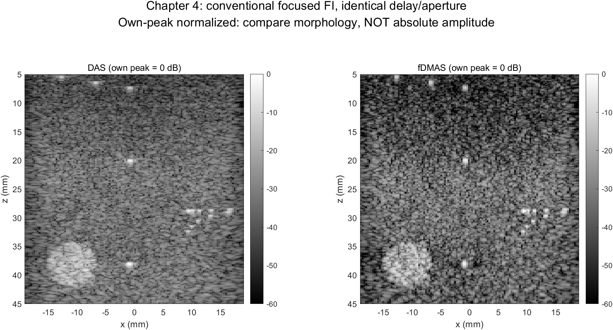

**图 13 怎么讲：** 先找上方点状目标、深部目标和左下方较亮区域，观察主要结构的位置是否相容；再看背景 speckle。fDMAS 的纹理更细碎，部分区域的明暗关系也发生变化。

两幅图都使用 −60–0 dB 的显示范围，但**各自全图最大值等于 0 dB**。相同灰阶只代表“相对各自参考值的相同比例”，不代表相同 RF 幅度、相同 SNR 或相同组织反射率。

### 9.3 第二眼看目标：把线上的点和频谱一起读

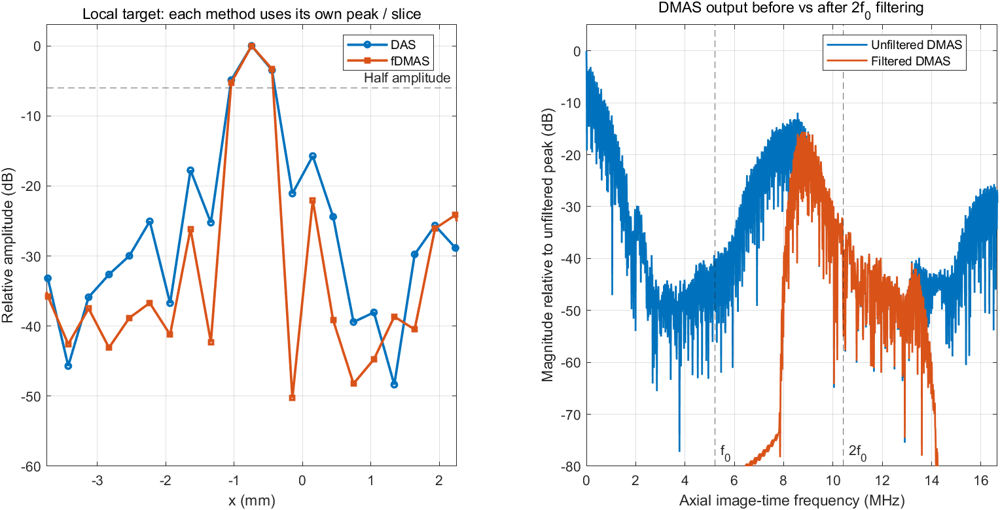

**图 14 怎么讲：** 左图的圆点、方点才是实际 scanline 位置，线段只是连接它们；两种方法各取自己的局部峰值深度。右图用同一个“未滤波 DMAS 频谱峰值”作参考，能看出低频被明显压低，以及原有高频能量被带通选择。

本例中，实际 DMAS 能量并不以 nominal 2f₀ 为严格中心。名义参数决定滤波器位置，实际回波决定输入谱形；两者要放在同一张图里看。

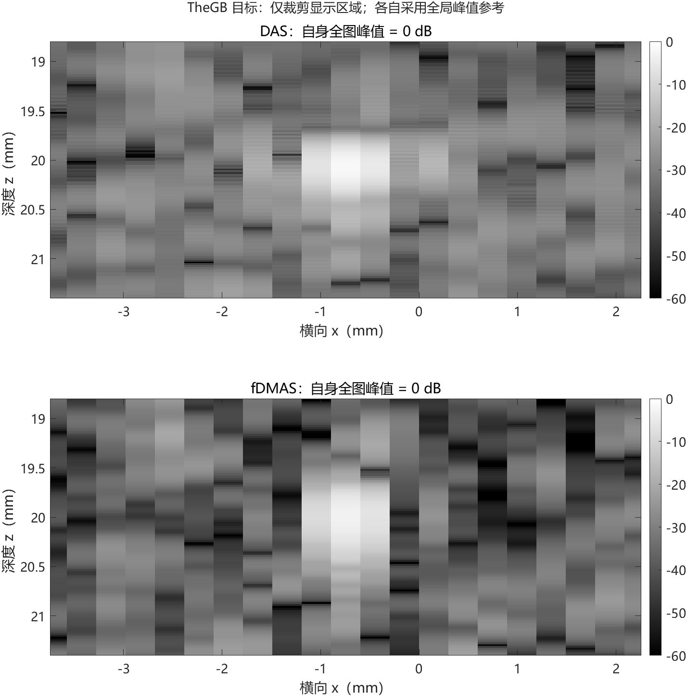

**图 15 怎么讲：** 这里只缩小显示范围，没有增加横向扫描线，也没有重新定义目标的物理尺寸。保留各自全图峰值参考，便于追踪它们在整幅图里的亮度位置；像素块清楚提醒我们横向采样仍然较粗。

### 9.4 第三眼读宽度：横向与轴向要分别看

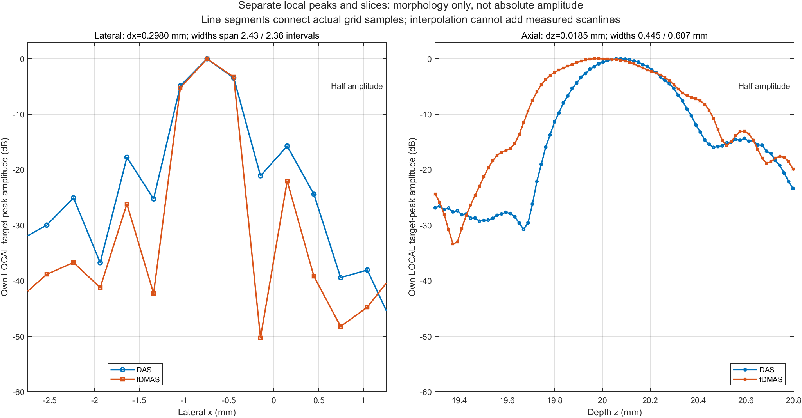

两种方法都在 x≈−0.74495 mm 附近找到目标，但各自的局部峰值深度略有不同。以下半幅全宽（FWHM）取**未截断的线性包络**，以各自局部峰值的一半为交点，计算左右交点之间的完整距离；交点在相邻样本之间线性插值：

| 本次局部目标读数 | DAS | fDMAS | 可以怎样解释 |
|---|---:|---:|---|
| 局部峰值深度 | 20.0762 mm | 19.9654 mm | 非线性组合与频带选择改变了目标响应形状及峰值位置 |
| 横向半幅宽度 | 0.7236 mm | 0.7023 mm | 数字接近，且只有约 2.43 / 2.36 个网格间距，不能声称精确的横向分辨率提升 |
| 轴向半幅宽度 | 0.4453 mm | 0.6072 mm | 本次 fDMAS 的轴向包络更宽，不能从 2f₀ 推出轴向必然更好 |

这里的半幅是包络幅度 0.5，换算为：

$$ 20\log_{10}(0.5)\approx-6.0206\ \mathrm{dB}. $$

它不是“功率减半”的 −3.0103 dB。插值宽度也不意味着实际采到了那么精细的横向位置。

**这一张图回答的就是本章最容易误解的问题：** 保留约 2f₀ 的振荡，不等于脉冲包络更短；本次横向与轴向的变化也不相同。响应形状由通道一致性、非线性运算、实际带宽与滤波窗口共同决定。

### 9.5 最后回到信号：图像变化来自哪些阶段？

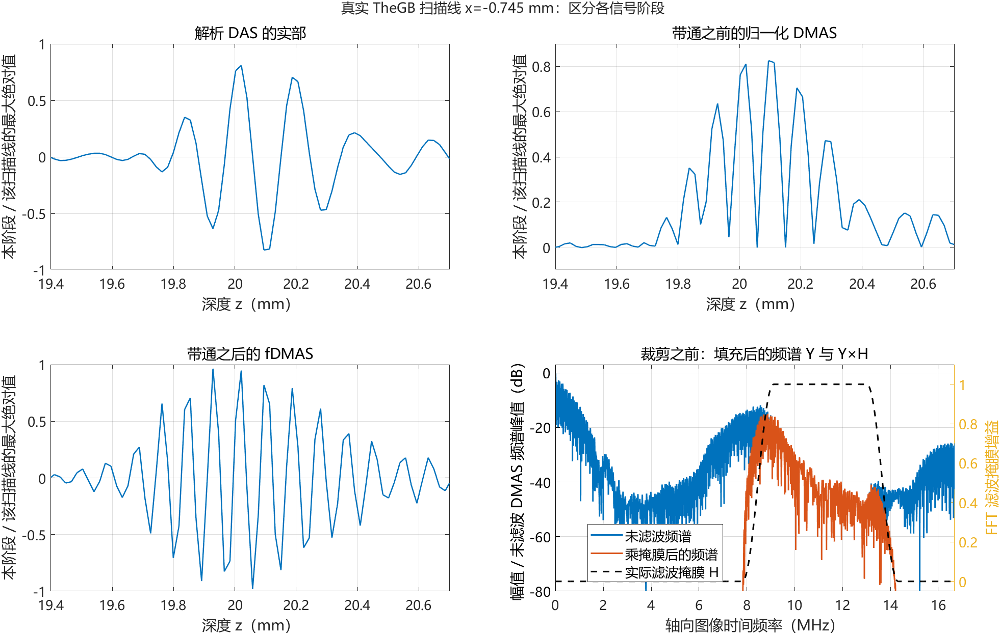

**图 17 怎么讲：** 按左上、右上、左下的顺序看波形，从有正负号的 DAS，走到带明显低频底座的 DMAS，再到重新以零附近振荡的带通输出。三条时域曲线分别除以各阶段全 scanline 的最大绝对值，仅用于看形状。

右下把**实际 padded FFT 的 Y、YH 和 H**放在一起，明确显示频域选择。它位于裁回原长度之前；对裁剪后的波形重新 FFT，会因截取边界产生频谱泄漏，不必在阻带中得到精确的零。

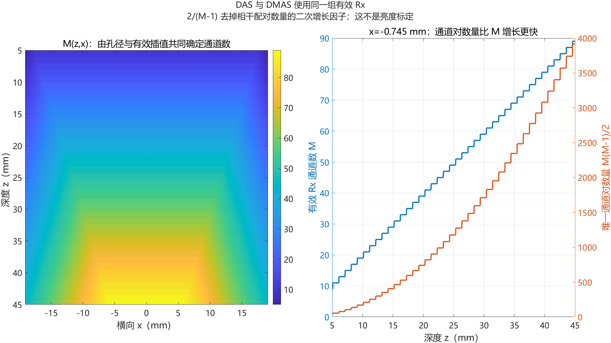

**图 18 怎么讲：** 左图是实际 M(z,x)，右图展示同一条 scanline 上 M 与 pair count 的变化。右侧两条曲线分别使用左右纵轴，要先读单位再比较。它把第 4 节的幅度约定与真实动态孔径联系起来：亮度变化不能只归因于“算法抑制了某种组织”。

本次实验支持的结论是：**fDMAS 通过非线性通道组合和后续频带选择，改变局部响应及 speckle 纹理；某些横向位置被压低，但整幅图像不能概括为全面优于 DAS。** 本章没有用未定义的 ROI 填写 CNR / gCNR / SNR，也没有把体模结果外推为临床结论。相干性与图像幅度的关系可结合 [Prieur 等人的论文及作者官方复现示例](https://unioslo.github.io/USTB/examples/publications/TUFFC/Prieur_fDMAS_2018/FI_UFF_FIeldII_simulations_Fig2_and_Fig3.html)继续学习。

## 10. 主线读完后，再集中核对这些注意事项

| 容易产生的理解 | 应怎样核对 |
|---|---|
| “不用 delay，反正后面会相乘” | 每个 pair 必须来自同一像素对应的延时取样；错误聚焦会改变相位一致性 |
| “DMAS 就是把 DAS 输出平方” | 快速式还减去了 self-pairs；而且先做的是每通道 signed square root |
| “既然平方根让幅度变回一次，就变成线性算法了” | 检查 D(−s)=D(s)，以及叠加是否成立；一次齐次关系不等于线性 |
| “normalized DMAS 等于 DAS” | 全相干时分别是 M 乘绝对 RF 与 Ms；一般输入和后续滤波响应也不同 |
| “这里的 DMAS 是相关系数” | pair sum 没有像归一化相关系数那样限定在 [−1,1]；它依赖幅度、符号、M 和本项目的 scaling |
| “把 IQ 或 envelope 代入同一个式子也可以” | 本章定义和实现明确使用 real RF；丢掉符号或改变复数运算会改变算法 |
| “全图更黑，表示去噪更成功” | 散斑组织和不充分对齐的真实目标也可能被改变；先定义信号、背景与评估 ROI |
| “2f₀ 就是组织二次谐波” | 本章讨论的是数字非线性产生的频谱；不能据此判定传播介质产生了二次谐波 |
| “Nyquist assert 通过，全部混叠问题就解决了” | assert 只覆盖所选带通上沿；更高谐波、输入采样和 image-time 近似需另外考虑 |
| “加密 z 会顺便提高横向采样” | x 仍由 128 个 focused source.x 决定；不能用插值后的光滑曲线当作新增测量 |
| “zero-phase 意味着有限区间没有边界问题” | zero-padding 减少环绕，不能消除有限长度 FFT / Hilbert 的所有边界效应 |
| “两图都 0 dB，所以幅度可以直接比较” | 先检查 global peak / local peak / common reference；fDMAS 的幅度约定也不等于 DAS 标定 |
| “回归检查通过，就是复现了全部 fDMAS 物理性能” | 当前独立复数回归验证 DAS 分支；pair identity 验证代数，图像实验验证这组实现的具体输出 |

### 调代码时，变量怎样对应理论？

核心文件是 [reconstruct_fi_dmas_fdmas_manual.m](../../matlab/04_DMAS/reconstruct_fi_dmas_fdmas_manual.m)。按下面顺序跟读即可：

| 变量 / 函数 | 形状或单位 | 作用 |
|---|---|---|
| rf_wave | [Ns,Nchannels]，实数 | 当前 Tx、当前帧的采集 RF |
| analytic_wave | 同上，复数 | 各通道沿采集时间的 analytic RF |
| tau / samples | [1,Nchannels]；tau 为 s | delay 与 fractional interpolation 的结果 |
| active / M | 逻辑向量 / 整数 | 几何接收孔径与插值有效性的交集 |
| s / rf / u | 单像素的有效通道向量 | 核心中 s 是复数 samples 子集，rf=real(s)，u 是实数 signed-sqrt |
| das_analytic | [Nz,Nx]，复数 | analytic RF 的相干求和 |
| dmas_unfiltered | [Nz,Nx]，实数 | 已带 2/(M−1) 约定的快速 DMAS |
| filter_mask | [Npad,1]，实数 | 沿第 1 维 FFT 的双边带通 |
| fdmas_filtered / fdmas_analytic | [Nz,Nx]，实数 / 复数 | 带通输出及其 analytic signal |
| das_envelope / fdmas_envelope | [Nz,Nx]，非负实数 | 各自 analytic output 的绝对值 |

正文公式用 s 表示 real RF；现有核心代码里局部变量 s 表示复数通道子集，随后用 rf=real(s) 进入 DMAS。阅读时留意这个命名差别，数值路径是明确的。

优先调 receive_f_number 或深度范围时，先固定其他条件，检查 M、输出采样率、频谱与目标剖面。滤波边界会改变输出脉冲和纹理，不能只挑一张更顺眼的图作为参数依据。

## 11. 用五个问题检查自己是否理解了主线

1. 为什么四个接收通道只有六个 pair，而不是十六个？
2. 所有 RF 通道同时反号，DAS 和 DMAS 分别怎样变化？
3. 为什么 O(M) 快速式要减去 sum(u.^2)？
4. 为什么 Δz=λ/4 的网格无法用于本章的 2f₀ 带通？
5. 为什么本次不能写“频率翻倍，所以分辨率翻倍”？

展开参考答案

1. 只计 i&lt;j：不含四个 self-pairs，也不重复计算 (j,i)，所以是 4×3/2=6。
2. 实数 DAS 反号；DMAS 不变。原始 DMAS 仍可能为负，全局反号不变不等于输出总是非负。
3. 和的平方包含每个通道自己的平方；减去它们，再除以 2，才留下每个唯一通道对一次。
4. 近似 image-time 采样率只有 2f₀，Nyquist 为 f₀，低于 2.75f₀ 的滤波上沿。
5. 2f₀ 是数字运算后的振荡频带，包络宽度还受带宽和通道响应影响；本次横向仅有约两个多网格间距，轴向包络反而更宽。

## 12. 复现入口与进一步阅读

~~~text
matlab/04_DMAS/
├─ demo_dmas_building_blocks.m        六组无需数据的原理演示
├─ reconstruct_fi_dmas_fdmas_manual.m conventional FI 的核心重建
├─ compare_fi_das_vs_fdmas.m          一个真实 TheGB 二维实验
├─ export_chapter4_figures.m          原理图、真实实验和诊断图导出
└─ README.md                          运行与复现说明
~~~

本章保留一个清楚的真实数据实验，新增图片用来解释同一条算法链，不继续增加 DMAS 派生算法。所有 6 张 AI 概念图与 12 张 MATLAB 图片、参数、提示词、原始结果和边界均在[配图索引](figures/README.md)中登记。

- Matrone G., Savoia A. S., Caliano G., Magenes G. (2015). *The Delay Multiply and Sum Beamforming Algorithm in Ultrasound B-Mode Medical Imaging*. IEEE TMI, 34(4), 940–949. [原始论文 DOI](https://doi.org/10.1109/TMI.2014.2371235)。
- Prieur F., Rindal O. M. H., Austeng A. (2018). *Signal Coherence and Image Amplitude With the Filtered Delay Multiply and Sum Beamformer*. IEEE TUFFC, 65(7), 1133–1140. [论文 DOI](https://doi.org/10.1109/TUFFC.2018.2831789)；[作者在 USTB 中的官方复现](https://unioslo.github.io/USTB/examples/publications/TUFFC/Prieur_fDMAS_2018/FI_UFF_FIeldII_simulations_Fig2_and_Fig3.html)。
- [USTB 官方 DMAS 源代码](https://github.com/unioslo/USTB/blob/master/%2Bpostprocess/delay_multiply_and_sum.m)：适合对照 pair loop、频带设置和 Hilbert 输出，阅读时注意本项目额外的 normalization 与 FFT 滤波约定。

下一章将学习 SLSC（Short-Lag Spatial Coherence）：在理解“通道对能提供什么信息”之后，进一步学习怎样利用短间距阵元的空间相关性形成成像量。
